# Design Document — Spot-In (v2)

> Design-review document for the Tech Architecture Group. Generated by the `design-document` skill from the
> codebase and the docs in this repo. The owner interview was not possible for this run, so every gap the
> code and docs cannot close is marked ⚠️ and collected in
> [Open questions for the owner](#open-questions-for-the-owner).
>
> **This is a second, independent version** written for comparison with [`docs/DESIGN.md`](DESIGN.md),
> which is unchanged. See [Appendix B](#appendix-b--relationship-to-docsdesignmd).

| | |
|---|---|
| **Product** | Spot-In — web marketplace connecting event organizers with malls, venues and space owners in Indonesia (course pilot MVP) |
| **Code reviewed** | `main` @ `4c7e982` (Builds 1–2) and `origin/build-3` @ `47e77a2` (PR #6, not merged: event pages, registration, passes, check-in, cancellations, post-event window and release, dashboards) |
| **Docs reviewed** | [`docs/PRD.md`](PRD.md) v1.2, [`docs/PRD-review.md`](PRD-review.md), [`docs/build-1-plan.md`](build-1-plan.md), [`AGENTS.md`](../AGENTS.md), [`docs/features.json`](features.json), [`docs/pilot-deletion.md`](pilot-deletion.md), `README.md`, `.env.example`, `docker-compose.yml`, `.github/workflows/ci.yml` |
| **Not present** | `PROJECT.md`, `docs/ARCHITECTURE.md`, `docs/API.md`, `docs/SECURITY.md`, `docs/DEPENDENCIES.md` — this document reads the code directly instead (⚠️ running `project-documenter` would create them) |
| **Evidence format** | `path:line` refers to the `origin/build-3` tree. Files that exist only on `build-3` (e.g. `src/server/lifecycle.ts`, `src/server/event-pages.ts`, `db/migrations/005_event_and_after.sql`) are named but not linked, because this document is merged into `main` first |
| **Verification tags** | **CONFIRMED** = the code does it; **CONTRADICTED** = a doc or comment claims it but the code does not; **UNVERIFIABLE** = depends on something outside the repo |
| **Diagram check** | Every Mermaid block parsed with `mmdc` (mermaid-cli 11.16.0) before finalizing |
| **Date** | 6 November 2026 |

---

## Product Overview & Objectives

- **What it is:** Spot-In is a responsive web marketplace (Bahasa Indonesia only) where **venue operators**
  (malls, halls, outdoor sites) list spaces with specs, a map pin, rate cards and an availability calendar,
  and **event organizers** search, shortlist and send one enquiry to several venues, negotiate versioned
  quotes, accept one, click-accept a pilot agreement and pay a deposit and balance through a **sandbox**
  payment flow. A confirmed booking can get an **unlisted event page** where invited **attendees** register
  for free and receive a QR pass; the organizer checks them in. After the event a 72-hour post-event window
  runs, problems can be reported, and a **simulated release** settles the money in a double-entry ledger. A
  single **Spot-In Admin** role (TOTP 2FA) invites pilot users, verifies operators, approves listings,
  resolves problems and edits settings (PRD §1.2, §4.3).
- **Problem solved:** booking event space in Indonesia runs on WhatsApp, PDFs and phone calls; organizers
  can't compare availability and prices, venues waste time on low-quality enquiries and manual quoting, and
  event registration is disconnected from the booking (PRD §1.1).
- **Context:** a student course project followed by a small invite-only pilot. **Pilot mode is always on**:
  no real money (payments are simulated; the server refuses to start with a live payment key), every booking
  is a non-binding practice booking, every PDF carries a PILOT watermark, event pages are never indexed, and
  no ID, tax or bank data is collected (`AGENTS.md`, PRD §3.3, `src/lib/config.ts:38-49`).
- **Objectives / success criteria** (PRD §3.1 MVP goals, §3.4 measures — ⚠️ owner to confirm these are the
  design's acceptance bar):

| ID | Objective | How the design supports it |
|---|---|---|
| PG1 | Enquiry → quote → revision → acceptance → pilot agreement → sandbox deposit → **Confirmed** → sandbox balance, without leaving Spot-In | Sequences B2–B4; booking state machine in C |
| PG2 | One enquiry to several venues, quotes compared side by side | Enquiry fan-out (≤ 5 per send, ≤ 10 open per event), comparison PDF (B2, B3) |
| PG3 | Confirmed booking → unlisted event page → registration → QR pass → check-in | Sequence B6 |
| PG4 | ≥ 1 real venue sends a real quote in the pilot | Operational, not provable in code ⚠️ |
| PG5 | No sensitive personal data; every user accepted the pilot notice | No such columns (`001_core.sql:1-3`), `scripts/pii-scan.ts`, `consent_records` |
| PG6 | Fees, PPN, deposit/balance, hold, release and refunds reconcile to the Rupiah | Integer-Rupiah math, append-only double-entry ledger, `reconcile()` (C, Financial Risks) |

  Course measures: all 7 demo scenarios D1–D7 pass without manual DB edits; zero ledger mismatches; pilot
  ≥ 1 real quote, ≥ 3 organizers, ≥ 20 registrations; zero blocked-data matches (PRD §3.4).
- **PRD:** [`docs/PRD.md`](PRD.md) v1.2 (5 Nov 2026), with the critical review log
  [`docs/PRD-review.md`](PRD-review.md). Requirement status lives in [`docs/features.json`](features.json).

---

## Business Workflow

**Intent:** turn a fragmented, chat-based process into one auditable loop — *find a space → agree a price →
commit (agreement + deposit) → prepare (documents, balance, event page) → run the event → settle* — where
every deadline is enforced by the system on the application clock and every Rupiah is traceable in a
ledger. In the pilot the loop is a realistic rehearsal: money and agreements are simulated, so venues and
organizers can practise the flow without legal or financial risk (PRD §1.2, decision #12).

Step ownership below follows the role matrix in PRD §4.3 and `src/lib/permissions.ts:10-38`; ⚠️ owner to
confirm the business intent wording.

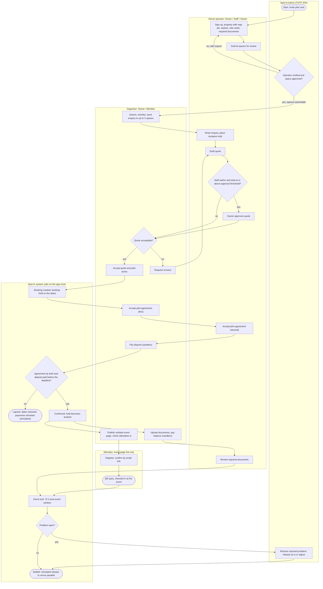

Not drawn (to keep the main path readable): cancellation by the organizer (Owner) or the venue (Owner) at
any point between Confirmed and the event, and the venue's no-show record on an event day — see sequence B8.
Backup quotes on held dates — see B5.

---

## Architecture Diagrams

### A. Component / Deployment Diagram

**Component view.** One Next.js 16 application (App Router, React 19, server actions, TypeScript strict)
running in one Node 22 process, backed by one PostgreSQL 16 database with PostGIS, pg_trgm, btree_gist,
citext and unaccent. There is no separate API service, queue broker or search engine: background work is a
`jobs` table polled on the application clock, and search is SQL. Data access is raw SQL through
[postgres.js](https://github.com/porsager/postgres) (`src/lib/db.ts`); the schema is five hand-written SQL
migrations (`db/migrations/001`–`005`, applied by `scripts/migrate.ts`). Every external call goes through
`src/adapters/*` (rule in `AGENTS.md`).

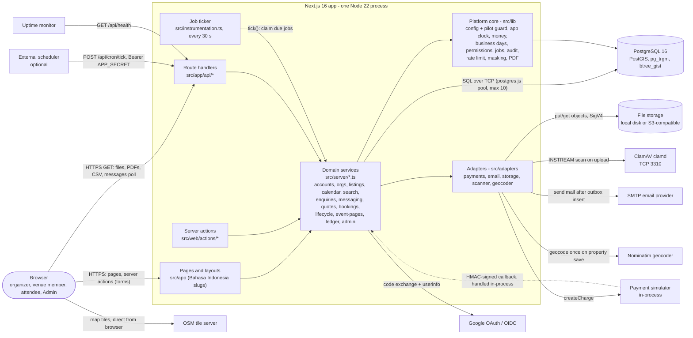

| Component | Responsibility | Evidence |
|---|---|---|
| Pages (`src/app`) | Server-rendered screens for venue (`/venue/*`), organizer (`/acara/*`, `/enquiry/*`, `/pemesanan/*`), attendee (`/e/[slug]`, `/kartu/*`), admin (`/admin/*`) | `src/app/**/page.tsx` |
| Server actions (`src/web/actions`) | Parse forms, resolve the session (`actor()`), call one service, map errors to catalog messages | `src/web/action.ts:12-29` |
| Route handlers (`src/app/api`) | File/PDF/CSV downloads, Google OAuth, payment webhook, cron tick, health | 15 `route.ts` files |
| Domain services (`src/server`) | All business rules and permission checks; framework-free; covered by Vitest integration tests on a real DB | `tests/*.test.ts` |
| Platform core (`src/lib`) | Pilot guard, app clock, integer-Rupiah math, business days, role tables, job queue, audit, rate limiter | `src/lib/*.ts` |
| Adapters (`src/adapters`) | Only place that talks to external systems; drivers switch by env (`EMAIL_DRIVER`, `STORAGE_DRIVER`, `SCANNER_DRIVER`, `GEOCODER_DRIVER`) | `src/lib/config.ts:14-30` |

**Deployment & access boundary.** ⚠️ No hosting provider, region, network layout or TLS terminator is chosen
yet (PRD §15.3 **Q21**; README describes only local and CI runs; `docker-compose.yml` is for development).
The diagram shows what the code requires; the zone placement of the database, storage and ClamAV is an
assumption to confirm.

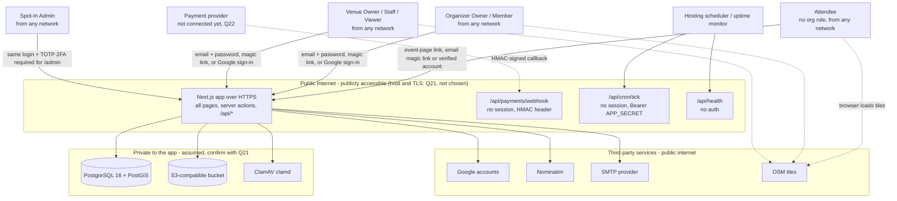

| Entry point | Who | Login method (from code) | Gate |
|---|---|---|---|
| All pages and server actions | Organizer, venue member, attendee | Email + password (argon2), email magic link, optional Google sign-in (consumer Google accounts, OIDC `openid email profile`); session cookie `spotin_session` (httpOnly, SameSite=Lax, `secure` when `APP_URL` is https, 30-day max age, idle revoke after `session_idle_days` = 30) | Invite-only sign-up (`pilot_invites` or `ADMIN_EMAILS`); verified email required for enquiry, quote, accept, pay, register (`src/server/access.ts:42-46`); role checks per action (`src/lib/permissions.ts`) |
| `/e/[slug]` (event page), `/kartu/[token]` (pass), `/s/[token]` (shared shortlist) | Anyone with the link | None to view; registering creates a quick-attendee account confirmed through an emailed link | Unguessable random slug/token; `noindex`, `robots.txt` disallows `/` |
| `/admin/*` | Spot-In Admin | Same login **plus** TOTP enrolled and passed in this session (`src/web/session.ts:36-41`) | `is_admin` flag (set when the sign-up email is in `ADMIN_EMAILS`); no network restriction ⚠️ |
| `/api/payments/webhook` | Payment provider (today: never called; the simulator calls the handler in-process) | HMAC-SHA256 `x-callback-signature` keyed with `APP_SECRET` | Signature check, dedupe on `(provider, event_id)` |
| `/api/cron/tick` | External scheduler (optional; the in-process ticker also runs) | `Authorization: Bearer $APP_SECRET`, constant-time compare | — |
| `/api/health` | Uptime monitor | None | Returns env name and pilot flag |
| `/dev/mail` | Developers | Session | 404 in `pilot` |

⚠️ **Login-method compliance gap.** The skill's standard requires **Apps Gateway SSO** or **Company Google
OAuth** on every entry point. Spot-In uses email/password, magic links and consumer Google sign-in for
external users, and the same methods (+ TOTP) for its Admin. For a public marketplace whose users are
outside the company this may be intended, but it is a deviation that needs an explicit decision (open
question 3).

### B. Sequence Diagrams & System Boundaries

Conventions: `box` = system boundary (blue = Spot-In, yellow = external). **Green `rect` = financial-asset
flow** (payment, refund, ledger posting, settlement). `alt` = role-based or state-based differences. All
times come from the application clock (`src/lib/clock.ts`). Major use cases follow the PRD demo script D1–D7
(PRD §13.1) — ⚠️ owner to confirm that these are the "major" flows.

**B1. Venue onboarding and listing review (D1)**

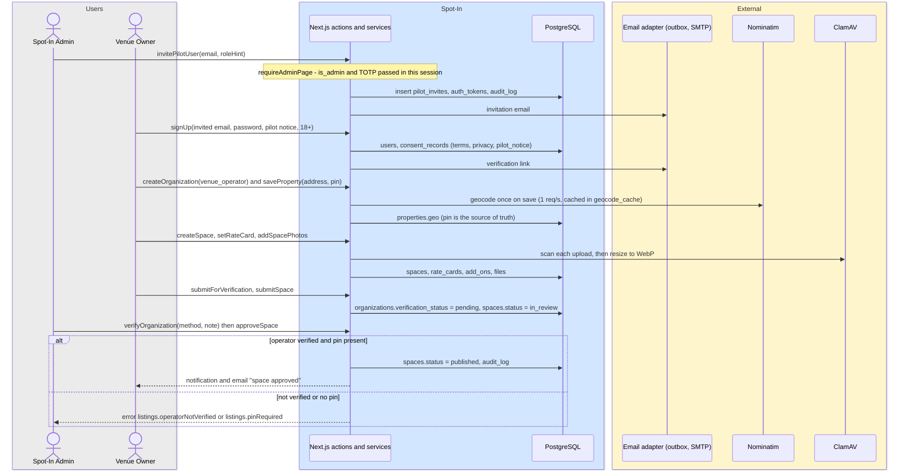

**B2. Search, shortlist, enquiry fan-out and tentative hold (D2)**

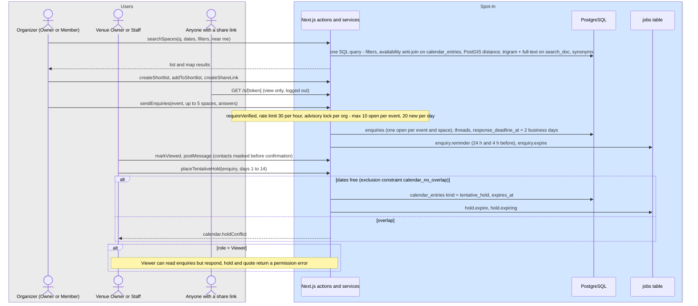

**B3. Quote, approval threshold, revision and acceptance (D3)**

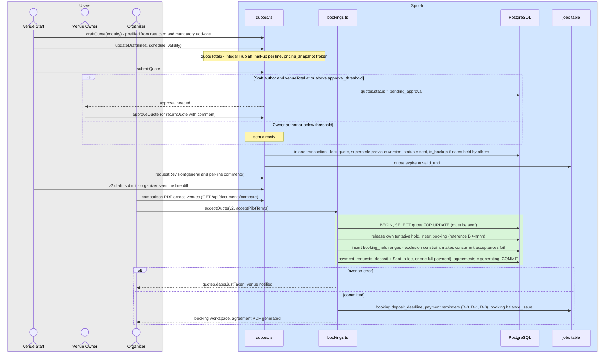

**B4. Pilot agreement, sandbox deposit, webhook and confirmation (D4, D5 balance)**

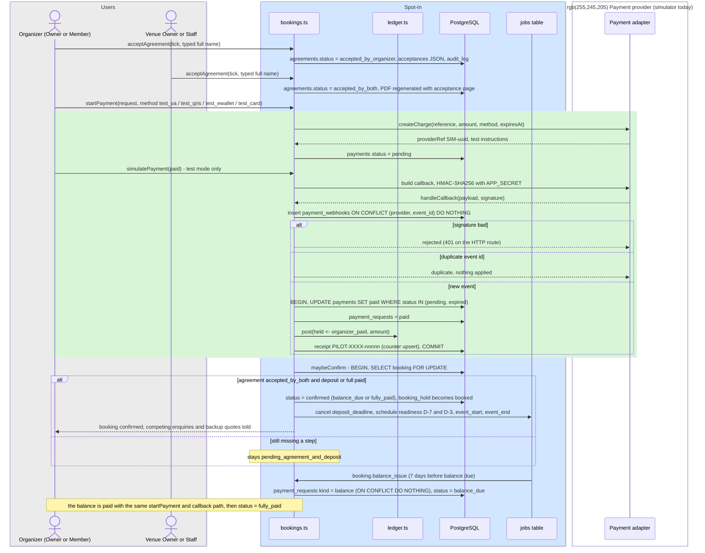

**B5. Lapse and backup quote on held dates (D4)**

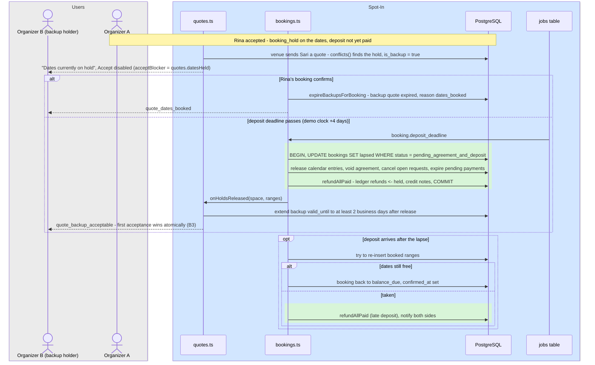

**B6. Event page, registration, pass and check-in (D5)**

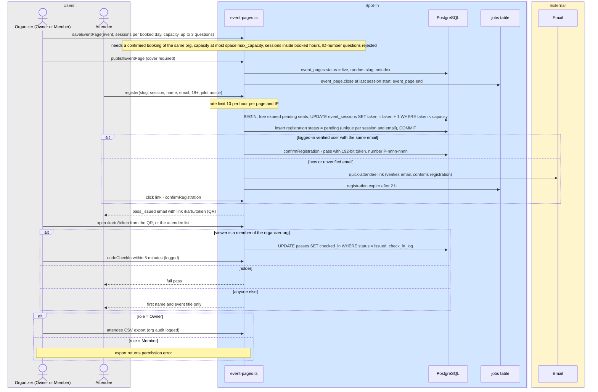

**B7. Post-event window, problem report and simulated release (D6)**

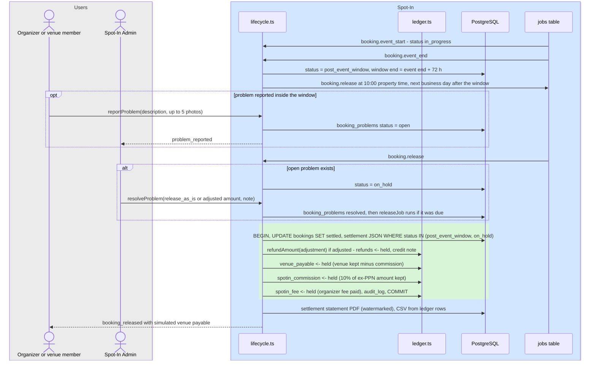

**B8. Cancellation by organizer or venue, and no-show (D7)**

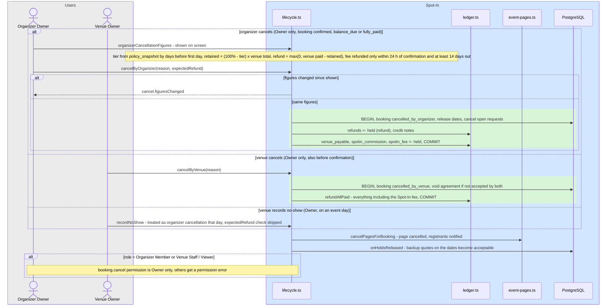

### C. Queue / Data Storage for Transactions

All transactional state lives in **one PostgreSQL database**. There is no message broker: the "queue" is
the `jobs` table, claimed with `FOR UPDATE SKIP LOCKED` and run when `run_at <= ` the application clock
(`src/lib/jobs.ts:37-66`). Money exists only as **integer Rupiah rows** — no real funds move in the pilot
(`src/adapters/payments.ts:5-11`).

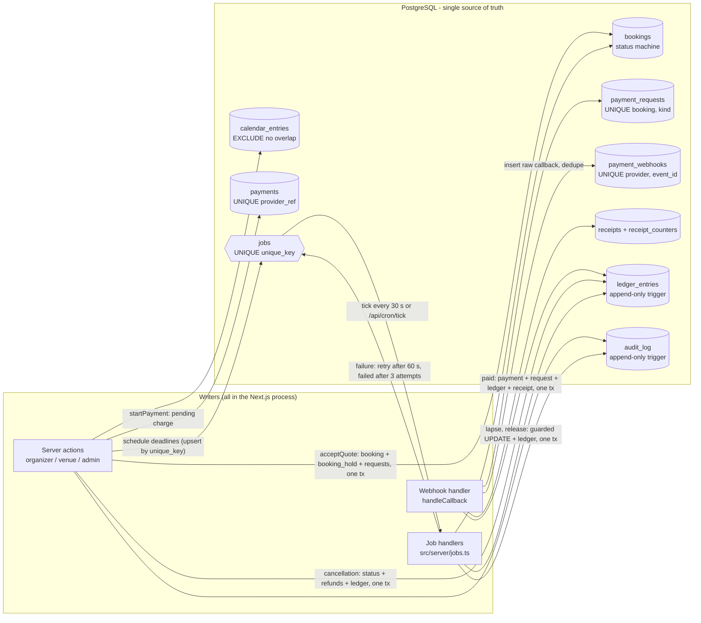

**Ledger accounts.** Each `ledger_entries` row moves `amount` from `credit_account` to `debit_account`
(`src/server/ledger.ts:4-24`). Arrows below point from the credited to the debited account:

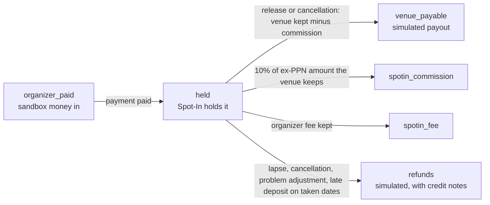

**Booking state machine as implemented** (`src/server/bookings.ts`, `src/server/lifecycle.ts`):

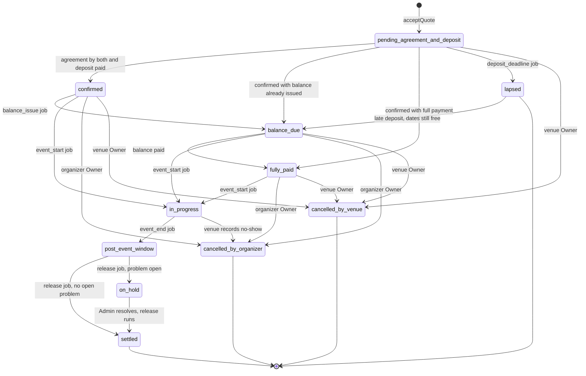

Differences from PRD §9.2 (AGENTS.md: "if code and PRD disagree, the PRD wins"): the code goes
`on_hold → settled` directly (PRD: `on_hold ⇄ post_event_window`); `event_end` also moves bookings that
never reached `in_progress`; a `lapsed` booking can come back on a late deposit (PRD §12.1 describes this);
registrations have a `pending` state the PRD machine lacks; payments never use the `created` state; and an
`expired` payment can still become `paid` (`src/server/bookings.ts:235`). ⚠️ owner to decide whether the PRD
or the code changes (open question 12).

- **Transaction ownership** (inferred from code — ⚠️ owner to confirm; there is one deployable, so
  "ownership" means the module that writes the rows):

| Data | Owning module (writer) | Other writers |
|---|---|---|
| `calendar_entries` | `calendar.ts` (blocks, tentative holds) | `bookings.ts` (booking hold, booked, lapse), `lifecycle.ts` (cancellation release) |
| `quotes` | `quotes.ts` | `bookings.ts` (accepted) |
| `bookings` | `bookings.ts` (create → confirmed, lapse, balance) | `lifecycle.ts` (in_progress → settled, cancellations, at-risk) |
| `payment_requests`, `payments`, `payment_webhooks`, `receipts` | `bookings.ts` | `lifecycle.ts` (refunds, cancellation) |
| `ledger_entries` | `ledger.ts#post` | called only from `bookings.ts` and `lifecycle.ts` |
| `event_sessions.taken`, `registrations`, `passes` | `event-pages.ts` | — |
| `jobs` | `lib/jobs.ts` | every module schedules/cancels by `unique_key` prefix |

- **Upstream systems with access:** only the Next.js process (one DB role from `DATABASE_URL`) reads or
  writes these tables. Views over the data: organizer and venue members of the booking see its workspace,
  receipts, statement and `reconcile()` result (`src/server/bookings.ts:463-486`); the Admin sees the sandbox
  ledger with reconciliation per booking (`src/app/admin/buku-besar/page.tsx`). No reporting replica, export
  job or BI tool exists in the code. ⚠️ Who has direct production DB access (FR-M38-06 "named team members,
  logged") is not in the repo.
- **Data movement:** no data leaves PostgreSQL except generated PDFs (to file storage), emails (to the SMTP
  provider) and user downloads. The payment provider only receives reference, amount, method and expiry.
- **Failure & recovery:**

| Failure | What happens | Recovery | Evidence |
|---|---|---|---|
| Crash inside a money transaction (accept, payment, lapse, cancel, release) | PostgreSQL rolls back the whole transaction | Re-run the action or the job; guarded `UPDATE … WHERE status …` makes payment, lapse and release safe to repeat | `bookings.ts:54-86, 234-242, 342-352`, `lifecycle.ts:257-268` |
| Crash after the transaction, before notifications / PDF | State is correct, a notification or PDF is missing | Agreement PDF retried by job (3 attempts, then Admin alert); receipt and statement PDFs are only logged ⚠️ | `bookings.ts:114-133, 245-251`, `lifecycle.ts:270-276` |
| Job handler throws | Job set back to `pending`, retried after 60 s; `failed` after 3 attempts | ⚠️ No alert or dashboard for `failed` jobs | `lib/jobs.ts:56-62` |
| Process dies while a job is `running` | Row stays `running` forever — never retried | ⚠️ No reaper; a missed `booking.deposit_deadline` or `booking.release` would never fire | `lib/jobs.ts:43-55` |
| Webhook stored but processing throws | Raw row kept with `processed_at` null; a provider retry is answered `duplicate` and not processed | ⚠️ No re-processing of unprocessed webhooks | `bookings.ts:212-229` |
| SMTP failure | `email_outbox.status = failed` | ⚠️ No resend; in-app notification still exists | `adapters/email.ts:27-33` |
| Database loss | — | ⚠️ PRD §8 requires a daily backup kept 7 days and one tested restore; not in the repo (depends on Q21) | — |
| Reconciliation mismatch | Shown on the booking workspace and the Admin ledger page | Manual; ⚠️ PRD §8 alert on reconciliation failure not implemented | `ledger.ts:41-61` |

---

## Database Schema

### Schema overview

57 tables in five migrations: `001_core.sql` (Build 1, 37 tables), `002_reference_data.sql` (holiday
calendar 2026–2027 from the SKB 3 Menteri lists, search synonyms), `003_search_doc.sql` (search text +
triggers + indexes), `004_quotes_bookings_payments.sql` (Build 2, 10 tables) and
`005_event_and_after.sql` (Build 3, 10 tables + booking columns). Conventions:

- Keys are random UUIDs (`gen_random_uuid()`); append-only logs use `bigserial`.
- Money is `bigint` integer Rupiah; rates are basis points (`*_bps`). Arithmetic is half-up per line
  (`src/lib/money.ts`).
- Timestamps are `timestamptz` written from the **application clock**, except the `default now()` columns
  of `settings`, `jobs.created_at` and `geocode_cache`.
- Database-enforced invariants: `calendar_no_overlap` EXCLUDE constraint (`001_core.sql:361`), append-only
  triggers on `audit_log`, `org_audit_log` and `ledger_entries`, `check (taken <= capacity)` on
  `event_sessions`, partial unique indexes for one open enquiry per (event, space), one open invite per
  email and one active registration per (session, email).
- Field descriptions below are inferred from code and comments — ⚠️ owner to confirm. Ownership per table
  group is the module named in each group.

**Identity, organizations and listings**

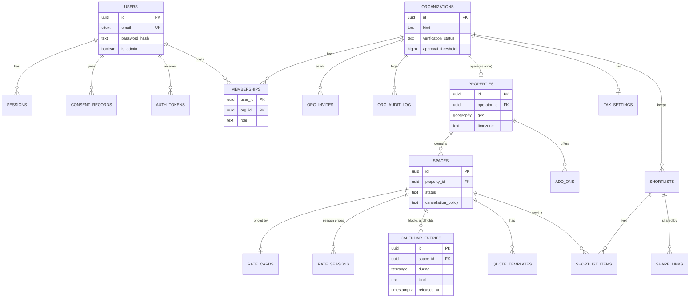

**Enquiries, quotes, bookings and money**

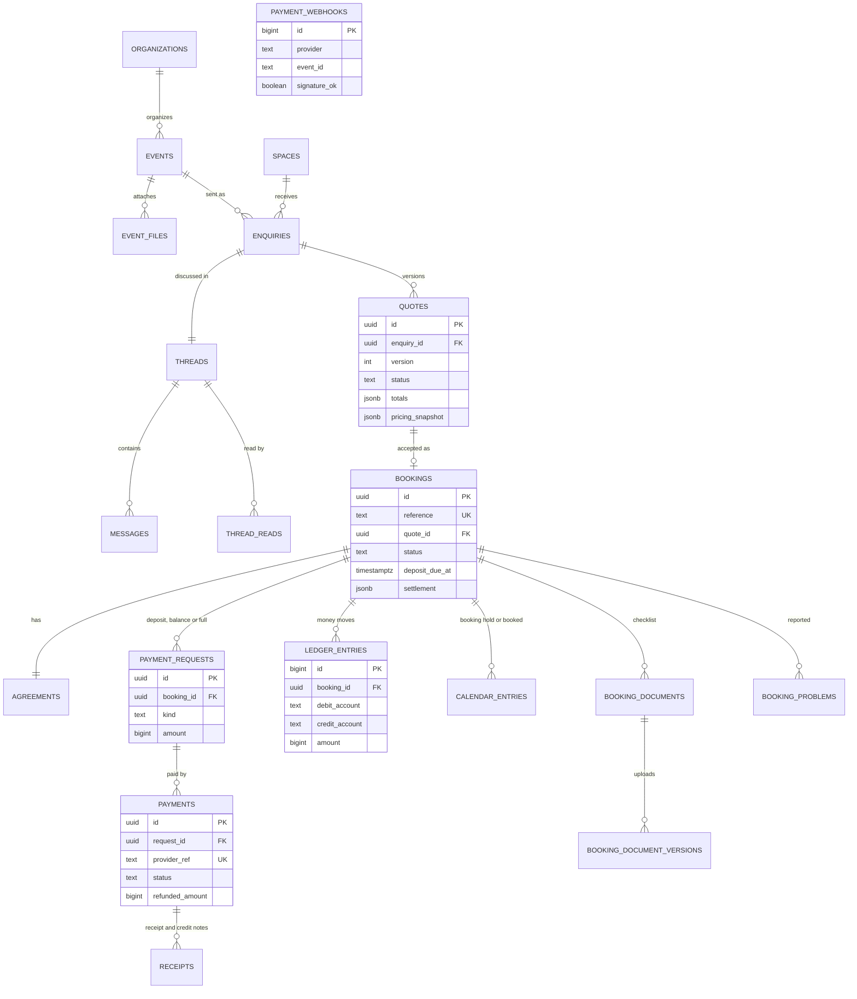

**Event pages, registration and passes**

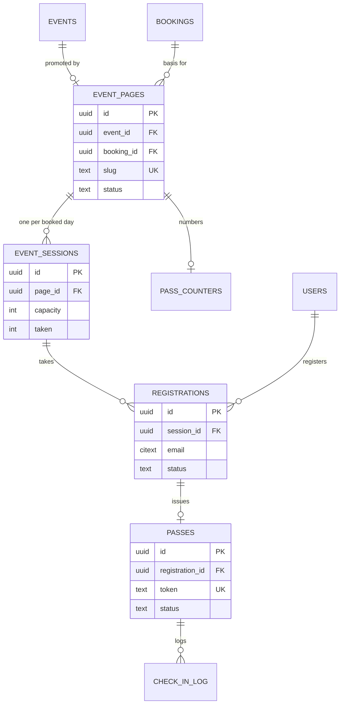

Tables with no FK relationships drawn: `settings`, `holiday_calendar`, `audit_log`, `jobs`, `rate_limits`,
`geocode_cache`, `search_synonyms`, `pilot_invites`, `files`, `saved_replies`, `reports`, `notifications`,
`email_outbox`, `receipt_counters`, `contact_messages` (several reference `users` or `organizations`; see
the field tables).

### Platform and operations tables

Settings, holiday calendar, audit, job queue, rate limiting and caches (`001_core.sql`, `002_reference_data.sql`). Owned by the platform core (`src/lib`).

**Table: `settings`**

| Field | Type | Nullable | Key | Description |
|---|---|---|---|---|
| `key` | text | no | PK | Setting name (see `src/lib/settings.ts` DEFAULT_SETTINGS; also `demo_clock_offset_ms`) |
| `value` | jsonb | no | — | JSON value; overrides the code default |
| `changed_by` | uuid | yes | — | Admin who last changed it (no FK) |
| `changed_at` | timestamptz | no | — | Last change time (database clock) |

**Table: `holiday_calendar`**

| Field | Type | Nullable | Key | Description |
|---|---|---|---|---|
| `date` | date | no | PK | Holiday date (Indonesia, SKB 3 Menteri list; Admin-editable) |
| `name` | text | no | — | Holiday name |
| `kind` | text | no | — | National holiday or cuti bersama; both are non-business days. One of: national, cuti_bersama |
| `year` | int | generated | — | Derived year, for the Admin listing |

**Table: `audit_log`**

| Field | Type | Nullable | Key | Description |
|---|---|---|---|---|
| `id` | bigserial | no | PK | Primary key (random UUID; bigserial for append-only logs) |
| `scope` | text | no | — | Who acted: admin, system (jobs) or user. One of: admin, system, user |
| `actor_id` | uuid | yes | — | Acting user (null for system); no FK so rows survive deletion |
| `action` | text | no | — | Event name, e.g. `booking.confirmed`, `quote.accepted` |
| `entity` | text | no | — | Entity type, e.g. booking, event_page, user |
| `entity_id` | text | yes | — | Entity id as text |
| `before` | jsonb | yes | — | State before the change (JSON) |
| `after` | jsonb | yes | — | State or figures after the change (JSON) |
| `ip` | text | yes | — | Client IP when known |
| `at` | timestamptz | no | — | Application-clock time of the event. Table is append-only (trigger) |

**Table: `jobs`**

| Field | Type | Nullable | Key | Description |
|---|---|---|---|---|
| `id` | bigserial | no | PK | Primary key (random UUID; bigserial for append-only logs) |
| `kind` | text | no | — | Handler name, e.g. `booking.deposit_deadline`, `booking.release` (`src/server/jobs.ts`) |
| `run_at` | timestamptz | no | — | Due time on the application clock |
| `payload` | jsonb | no | — | Handler arguments (ids) |
| `unique_key` | text | yes | UNIQUE | Idempotent scheduling key, e.g. `booking:<id>:release`; re-scheduling upserts |
| `status` | text | no | — | Lifecycle of the job row. One of: pending, running, done, failed, cancelled |
| `attempts` | int | no | — | Number of claims; after 3 failures the job is `failed` |
| `last_error` | text | yes | — | Last handler error text |
| `created_at` | timestamptz | no | — | When the row was created (application clock) |
| `done_at` | timestamptz | yes | — | When the handler finished |

**Table: `rate_limits`**

| Field | Type | Nullable | Key | Description |
|---|---|---|---|---|
| `key` | text | no | PK | Limiter key, e.g. `register:<page>:<ip>`, `enquiry-send:<user>` |
| `window_start` | timestamptz | no | PK | Start of the fixed window |
| `count` | int | no | — | Hits in the window |

**Table: `geocode_cache`**

| Field | Type | Nullable | Key | Description |
|---|---|---|---|---|
| `query` | text | no | PK | Normalised address query |
| `lat` | double precision | yes | — | Latitude (null = no result, cached) |
| `lon` | double precision | yes | — | Longitude |
| `display_name` | text | yes | — | Nominatim display name |
| `fetched_at` | timestamptz | no | — | When Nominatim was called |

**Table: `search_synonyms`**

| Field | Type | Nullable | Key | Description |
|---|---|---|---|---|
| `term` | text | no | PK | Search term, e.g. `jaksel` |
| `expansion` | text | no | — | Expansion, e.g. `jakarta selatan` |

### Identity, consent and sessions (M1, M38)

Owned by `src/server/accounts.ts` and `src/server/admin.ts` (pilot invites). No column exists for ID documents, NIK, NPWP, NIB, bank or card numbers (FR-M38-04).

**Table: `users`**

| Field | Type | Nullable | Key | Description |
|---|---|---|---|---|
| `id` | uuid | no | PK | Primary key (random UUID; bigserial for append-only logs) |
| `name` | text | no | — | Full name; also the name typed to accept the agreement |
| `email` | citext | no | UNIQUE | Login identity, case-insensitive, unique |
| `email_verified_at` | timestamptz | yes | — | Set by the verification link, magic link or Google; required for enquiry, quote, accept, pay, register |
| `password_hash` | text | yes | — | argon2 hash; null for magic-link/Google-only users |
| `google_sub` | text | yes | UNIQUE | Google account subject id |
| `phone` | text | yes | — | Optional, unverified; shown to the other party only after confirmation |
| `photo_file_id` | uuid | yes | — | Avatar file (no FK) |
| `totp_secret` | text | yes | — | TOTP secret for 2FA (stored as given; ⚠️ not encrypted at rest) |
| `totp_enabled_at` | timestamptz | yes | — | 2FA enrolled (required for Admin pages) |
| `is_admin` | boolean | no | — | Spot-In Admin flag (set at sign-up when the email is in `ADMIN_EMAILS`) |
| `is_18_plus_confirmed` | boolean | no | — | 18+ self-confirmation at sign-up/registration |
| `intents` | text[] | no | — | `find` and/or `list` chosen after sign-up |
| `intent_chosen_at` | timestamptz | yes | — | When the intent was chosen |
| `is_quick_attendee` | boolean | no | — | Account created by an event registration |
| `notification_prefs` | jsonb | no | — | Optional-email preferences |
| `email_bounced_at` | timestamptz | yes | — | Last bounce recorded (FR-M21-07) |
| `status` | text | no | — | Account state. One of: active, suspended, deleted |
| `suspended_reason` | text | yes | — | Admin reason |
| `created_at` | timestamptz | no | — | When the row was created (application clock) |
| `last_active_at` | timestamptz | yes | — | Last session activity |
| `deletion_requested_at` | timestamptz | yes | — | Self-service deletion requested |
| `deleted_at` | timestamptz | yes | — | Anonymised |

**Table: `consent_records`**

| Field | Type | Nullable | Key | Description |
|---|---|---|---|---|
| `id` | bigserial | no | PK | Primary key (random UUID; bigserial for append-only logs) |
| `user_id` | uuid | no | FK→users | Consenting user |
| `document` | text | no | — | Which document was accepted. One of: terms, privacy, pilot_notice |
| `version` | text | no | — | Document version (settings `*_version`) |
| `accepted_at` | timestamptz | no | — | Acceptance time |
| `ip` | text | yes | — | Client IP |

**Table: `pilot_invites`**

| Field | Type | Nullable | Key | Description |
|---|---|---|---|---|
| `id` | uuid | no | PK | Primary key (random UUID; bigserial for append-only logs) |
| `email` | citext | no | — | Invited email (one open invite per email) |
| `invited_by` | uuid | yes | FK→users | Admin |
| `role_hint` | text | no | — | Which side the person is expected to use. One of: venue, organizer, both |
| `status` | text | no | — | Invite state. One of: pending, accepted, revoked |
| `expires_at` | timestamptz | no | — | Expiry |
| `created_at` | timestamptz | no | — | When the row was created (application clock) |
| `accepted_at` | timestamptz | yes | — | Sign-up time |

**Table: `sessions`**

| Field | Type | Nullable | Key | Description |
|---|---|---|---|---|
| `id` | uuid | no | PK | Primary key (random UUID; bigserial for append-only logs) |
| `token_hash` | text | no | UNIQUE | SHA-256 of the cookie token (`spotin_session`) |
| `user_id` | uuid | no | FK→users | Owner of the session |
| `created_at` | timestamptz | no | — | When the row was created (application clock) |
| `last_seen_at` | timestamptz | no | — | Refreshed at most once a minute; idle sessions beyond `session_idle_days` are revoked |
| `user_agent` | text | yes | — | Browser user agent |
| `ip` | text | yes | — | Client IP |
| `two_factor_passed` | boolean | no | — | TOTP passed in this session (Admin pages require it) |
| `context` | text | yes | — | Current side (venue/organizer) for users in both. One of: venue, organizer |
| `revoked_at` | timestamptz | yes | — | Logout, revoke, password reset or idle |

**Table: `auth_tokens`**

| Field | Type | Nullable | Key | Description |
|---|---|---|---|---|
| `id` | uuid | no | PK | Primary key (random UUID; bigserial for append-only logs) |
| `purpose` | text | no | — | What the one-time token is for. One of: verify_email, magic_link, password_reset, pilot_invite, org_invite |
| `token_hash` | text | no | UNIQUE | SHA-256 of the emailed token |
| `user_id` | uuid | yes | FK→users | Target user when known |
| `email` | citext | yes | — | Target email (invites) |
| `data` | jsonb | no | — | Context, e.g. `{registrationId, redirect}` |
| `expires_at` | timestamptz | no | — | Expiry |
| `used_at` | timestamptz | yes | — | Single use |
| `created_at` | timestamptz | no | — | When the row was created (application clock) |

**Table: `files`**

| Field | Type | Nullable | Key | Description |
|---|---|---|---|---|
| `id` | uuid | no | PK | Primary key (random UUID; bigserial for append-only logs) |
| `storage_key` | text | no | UNIQUE | Object key in local/S3 storage (`<purpose>/<xx>/<uuid>`) |
| `filename` | text | no | — | Sanitised original name |
| `mime` | text | no | — | Sniffed type; images are re-encoded to WebP |
| `size_bytes` | int | no | — | Stored size |
| `purpose` | text | no | — | Upload purpose; drives size/type rules. One of: space_photo, property_photo, logo, avatar, proposal, message_attachment |
| `scan_status` | text | no | — | Virus-scan result; only `clean` files are stored and served. One of: clean, infected, error |
| `uploaded_by` | uuid | yes | FK→users | Uploader |
| `created_at` | timestamptz | no | — | When the row was created (application clock) |

### Organizations and roles (M2, M3)

Owned by `src/server/orgs.ts`; verification fields written by `src/server/admin.ts`.

**Table: `organizations`**

| Field | Type | Nullable | Key | Description |
|---|---|---|---|---|
| `id` | uuid | no | PK | Primary key (random UUID; bigserial for append-only logs) |
| `kind` | text | no | — | Venue operator or organizer organization. One of: venue_operator, organizer |
| `display_name` | text | no | — | Public name |
| `legal_name` | text | yes | — | Free text only (no NPWP/NIB) |
| `logo_file_id` | uuid | yes | FK→files | Logo |
| `city` | text | yes | — | City |
| `contact_email` | citext | yes | — | Contact email |
| `contact_phone` | text | yes | — | Contact phone |
| `is_individual` | boolean | no | — | Operator is a person, not a company |
| `verification_status` | text | no | — | Manual "Verified by Spot-In" state |
| `verification_submitted_at` | timestamptz | yes | — | Submitted for verification |
| `verified_by_spotin_at` | timestamptz | yes | — | When the Admin verified |
| `verification_method` | text | yes | — | call / chat / meeting |
| `verification_note` | text | yes | — | Admin note |
| `verification_reason` | text | yes | — | Rejection reason |
| `approval_threshold` | bigint | yes | — | Rupiah; Staff quotes at or above it need Owner approval |
| `status` | text | no | — | Suspension state. One of: active, suspended |
| `suspended_reason` | text | yes | — | Admin reason |
| `created_at` | timestamptz | no | — | When the row was created (application clock) |

**Table: `memberships`**

| Field | Type | Nullable | Key | Description |
|---|---|---|---|---|
| `user_id` | uuid | no | PK, FK→users | Member |
| `org_id` | uuid | no | PK, FK→organizations | Organization |
| `org_kind` | text | no | — | Copy of the org kind; UNIQUE(user_id, org_kind) = at most one venue and one organizer org per user. One of: venue_operator, organizer |
| `role` | text | no | — | Venue: owner/staff/viewer; organizer: owner/member (checked) |
| `created_at` | timestamptz | no | — | Joined |

**Table: `org_invites`**

| Field | Type | Nullable | Key | Description |
|---|---|---|---|---|
| `id` | uuid | no | PK | Primary key (random UUID; bigserial for append-only logs) |
| `org_id` | uuid | no | FK→organizations | Inviting organization |
| `email` | citext | no | — | Invitee |
| `role` | text | no | — | Role on acceptance |
| `token_hash` | text | no | UNIQUE | SHA-256 of the emailed token |
| `invited_by` | uuid | yes | FK→users | Inviting Owner |
| `expires_at` | timestamptz | no | — | 7-day expiry |
| `accepted_at` | timestamptz | yes | — | Accepted |
| `revoked_at` | timestamptz | yes | — | Revoked |
| `created_at` | timestamptz | no | — | When the row was created (application clock) |

**Table: `org_audit_log`**

| Field | Type | Nullable | Key | Description |
|---|---|---|---|---|
| `id` | bigserial | no | PK | Primary key (random UUID; bigserial for append-only logs) |
| `org_id` | uuid | no | FK→organizations | Organization |
| `actor_id` | uuid | yes | — | Acting user |
| `action` | text | no | — | Membership, role, threshold changes, attendee exports |
| `details` | jsonb | no | — | Details (JSON) |
| `at` | timestamptz | no | — | Time. Append-only (trigger) |

### Listings, pricing and calendar (M4–M6)

Owned by `src/server/listings.ts` and `src/server/calendar.ts`; the calendar is also written by quotes/bookings/lifecycle when holds convert, lapse or are cancelled.

**Table: `properties`**

| Field | Type | Nullable | Key | Description |
|---|---|---|---|---|
| `id` | uuid | no | PK | Primary key (random UUID; bigserial for append-only logs) |
| `operator_id` | uuid | no | FK→organizations, UNIQUE | Venue operator; UNIQUE = one property per operator |
| `name` | text | no | — | Property name |
| `type` | text | no | — | Property type. One of: mall, hall, convention_centre, outdoor_site, other |
| `address_text` | text | no | — | Typed address |
| `city` | text | no | — | City (search filter) |
| `area` | text | yes | — | Area/district |
| `geo` | geography(Point, 4326) | yes | — | Map pin (PostGIS point); required to submit; GiST-indexed for distance |
| `timezone` | text | no | — | WIB/WITA/WIT; all deadlines are computed in it. One of: Asia/Jakarta, Asia/Makassar, Asia/Jayapura |
| `operating_hours` | jsonb | no | — | Per weekday open/close |
| `parking_notes` | text | yes | — | Free text |
| `loading_notes` | text | yes | — | Free text |
| `house_rules` | text | yes | — | Free text |
| `photos` | jsonb | no | — | `[{fileId, caption}]` |
| `required_docs` | jsonb | no | — | Checklist template copied to each confirmed booking |
| `created_at` | timestamptz | no | — | When the row was created (application clock) |
| `updated_at` | timestamptz | no | — | Last change (application clock) |

**Table: `spaces`**

| Field | Type | Nullable | Key | Description |
|---|---|---|---|---|
| `id` | uuid | no | PK | Primary key (random UUID; bigserial for append-only logs) |
| `property_id` | uuid | no | FK→properties | Parent property |
| `name` | text | no | — | Space name |
| `type` | text | no | — | Space type. One of: atrium, booth, popup_unit, event_hall, function_room, outdoor_area, other |
| `level_text` | text | yes | — | Floor/level |
| `area_m2` | numeric(10, 2) | yes | — | Area |
| `ceiling_height_m` | numeric(6, 2) | yes | — | Ceiling height |
| `capacities` | jsonb | no | — | Capacity per layout |
| `max_capacity` | int | generated | — | Derived max of layouts; caps event-page session capacity |
| `power_kva` | int | yes | — | Available power |
| `environment` | text | no | — | Indoor/outdoor/covered. One of: indoor, outdoor, covered |
| `wifi` | boolean | no | — | Wi-Fi available |
| `accessibility_notes` | text | yes | — | Free text |
| `permitted_activities` | text[] | no | — | Allowed activities |
| `prohibited_categories` | text | yes | — | Free text |
| `min_days` | int | no | — | Minimum booking days |
| `max_days` | int | yes | — | Maximum booking days |
| `media` | jsonb | no | — | Up to 15 photos |
| `video_url` | text | yes | — | Video link |
| `enquiry_questions` | jsonb | no | — | Up to 5 questions for organizers |
| `cancellation_policy` | text | no | — | Policy copied into each quote. One of: flexible, moderate, strict |
| `buffer_hours` | int | no | — | Gap required between bookings |
| `status` | text | no | — | Listing review state (Admin approves `in_review`). One of: draft, in_review, published, unpublished, suspended |
| `review_reason` | text | yes | — | Admin rejection reason |
| `submitted_at` | timestamptz | yes | — | Submitted for review |
| `published_at` | timestamptz | yes | — | Published |
| `created_at` | timestamptz | no | — | When the row was created (application clock) |
| `updated_at` | timestamptz | no | — | Last change (application clock) |
| `search_doc` | text | no | — | Unaccented lower-case search text maintained by triggers (003) |
| `search_tsv` | tsvector | generated | — | Full-text vector of `search_doc` |

**Table: `rate_cards`**

| Field | Type | Nullable | Key | Description |
|---|---|---|---|---|
| `space_id` | uuid | no | PK, FK→spaces | Space (one rate card per space) |
| `unit` | text | no | — | Pricing unit. One of: hour, half_day, day |
| `weekday_price` | bigint | no | — | Integer Rupiah |
| `weekend_price` | bigint | yes | — | Integer Rupiah |
| `min_units` | int | no | — | Minimum units |
| `min_spend` | bigint | yes | — | Minimum spend (Rupiah) |
| `show_full_rate_card` | boolean | no | — | Show full card publicly or only the from-price |
| `from_price` | bigint | no | — | Headline "from" price (always required) |

**Table: `rate_seasons`**

| Field | Type | Nullable | Key | Description |
|---|---|---|---|---|
| `id` | uuid | no | PK | Primary key (random UUID; bigserial for append-only logs) |
| `space_id` | uuid | no | FK→spaces | Space |
| `name` | text | no | — | Season name |
| `start_date` | date | no | — | First day |
| `end_date` | date | no | — | Last day |
| `price` | bigint | no | — | Seasonal price (Rupiah) |

**Table: `add_ons`**

| Field | Type | Nullable | Key | Description |
|---|---|---|---|---|
| `id` | uuid | no | PK | Primary key (random UUID; bigserial for append-only logs) |
| `property_id` | uuid | no | FK→properties | Property |
| `name` | text | no | — | Add-on name |
| `unit` | text | no | — | Charging unit. One of: per_day, per_kva_day, per_person, per_item |
| `price` | bigint | no | — | Integer Rupiah |
| `taxable` | boolean | no | — | Subject to PPN |
| `mandatory` | boolean | no | — | Prefilled into every quote |

**Table: `tax_settings`**

| Field | Type | Nullable | Key | Description |
|---|---|---|---|---|
| `operator_id` | uuid | no | PK, FK→organizations | Venue operator |
| `is_pkp` | boolean | no | — | Venue charges PPN |
| `service_charge_bps` | int | no | — | Service charge in basis points |

**Table: `calendar_entries`**

| Field | Type | Nullable | Key | Description |
|---|---|---|---|---|
| `id` | uuid | no | PK | Primary key (random UUID; bigserial for append-only logs) |
| `space_id` | uuid | no | FK→spaces | Space |
| `during` | tstzrange | no | — | Time range; EXCLUDE constraint `calendar_no_overlap` forbids overlapping active entries per space |
| `kind` | text | no | — | Block, tentative hold, booking hold or booked. One of: block, tentative_hold, booking_hold, booked |
| `enquiry_id` | uuid | yes | — | Enquiry that placed a hold (no FK) |
| `booking_id` | uuid | yes | FK→bookings | Booking (FK added in 004) |
| `series_id` | uuid | yes | — | Weekly recurring block series |
| `reason` | text | yes | — | Private venue note |
| `expires_at` | timestamptz | yes | — | Hold expiry (tentative hold, booking hold = deposit deadline) |
| `released_at` | timestamptz | yes | — | Set when released; releases the slot for the constraint |
| `release_reason` | text | yes | — | expired, released, converted_to_booking_hold, lapsed, cancelled … |
| `created_by` | uuid | yes | FK→users | Actor |
| `created_at` | timestamptz | no | — | When the row was created (application clock) |

### Search, shortlists, events, enquiries and messaging (M7–M10)

Owned by `src/server/search.ts`, `src/server/enquiries.ts` and `src/server/messaging.ts`.

**Table: `shortlists`**

| Field | Type | Nullable | Key | Description |
|---|---|---|---|---|
| `id` | uuid | no | PK | Primary key (random UUID; bigserial for append-only logs) |
| `org_id` | uuid | no | FK→organizations | Organizer org |
| `name` | text | no | — | Name |
| `created_by` | uuid | yes | FK→users | Creator |
| `created_at` | timestamptz | no | — | When the row was created (application clock) |

**Table: `shortlist_items`**

| Field | Type | Nullable | Key | Description |
|---|---|---|---|---|
| `shortlist_id` | uuid | no | PK, FK→shortlists | Shortlist |
| `space_id` | uuid | no | PK, FK→spaces | Space |
| `note` | text | yes | — | Organizer note |
| `added_at` | timestamptz | no | — | Added |

**Table: `share_links`**

| Field | Type | Nullable | Key | Description |
|---|---|---|---|---|
| `id` | uuid | no | PK | Primary key (random UUID; bigserial for append-only logs) |
| `shortlist_id` | uuid | no | FK→shortlists | Shortlist |
| `token` | text | no | UNIQUE | Random view-only token (`/s/<token>`) |
| `created_by` | uuid | yes | FK→users | Creator |
| `created_at` | timestamptz | no | — | When the row was created (application clock) |
| `revoked_at` | timestamptz | yes | — | Revoked |

**Table: `events`**

| Field | Type | Nullable | Key | Description |
|---|---|---|---|---|
| `id` | uuid | no | PK | Primary key (random UUID; bigserial for append-only logs) |
| `organizer_org_id` | uuid | no | FK→organizations | Organizer org |
| `name` | text | no | — | Event name |
| `type` | text | no | — | Event type |
| `brand` | text | yes | — | Brand |
| `category` | text | no | — | Category |
| `description` | text | yes | — | Description |
| `expected_attendance` | int | no | — | Expected attendance |
| `days` | jsonb | no | — | Requested days with local start/end times |
| `budget_min` | bigint | yes | — | Budget (Rupiah) |
| `budget_max` | bigint | yes | — | Budget (Rupiah) |
| `required_facilities` | text[] | no | — | Facilities |
| `created_by` | uuid | yes | FK→users | Creator |
| `created_at` | timestamptz | no | — | When the row was created (application clock) |
| `updated_at` | timestamptz | no | — | Last change (application clock) |

**Table: `event_files`**

| Field | Type | Nullable | Key | Description |
|---|---|---|---|---|
| `event_id` | uuid | no | PK, FK→events | Event |
| `file_id` | uuid | no | PK, FK→files | Proposal file |

**Table: `enquiries`**

| Field | Type | Nullable | Key | Description |
|---|---|---|---|---|
| `id` | uuid | no | PK | Primary key (random UUID; bigserial for append-only logs) |
| `event_id` | uuid | no | FK→events | Event |
| `space_id` | uuid | no | FK→spaces | Space; one open enquiry per (event, space) (partial unique index) |
| `status` | text | no | — | Enquiry state machine (PRD §9.2). One of: submitted, viewed, info_requested, responded, quoted, accepted, declined, expired, withdrawn, lost |
| `answers` | jsonb | no | — | Answers to the space questions |
| `warnings` | text[] | no | — | Pre-submit warnings shown |
| `response_deadline_at` | timestamptz | no | — | 2 business days, property time zone |
| `first_response_at` | timestamptz | yes | — | First venue response |
| `viewed_at` | timestamptz | yes | — | First viewed by venue |
| `assigned_member_id` | uuid | yes | FK→users | Venue member |
| `internal_notes` | text | yes | — | Venue-only notes |
| `decline_reason` | text | yes | — | Decline reason. One of: dates_unavailable, capacity, proposal_not_suitable, other |
| `decline_note` | text | yes | — | Free text |
| `lost_reason` | text | yes | — | Why marked lost |
| `closed_at` | timestamptz | yes | — | Closed |
| `created_by` | uuid | yes | FK→users | Creator |
| `created_at` | timestamptz | no | — | When the row was created (application clock) |
| `updated_at` | timestamptz | no | — | Last change (application clock) |

**Table: `threads`**

| Field | Type | Nullable | Key | Description |
|---|---|---|---|---|
| `id` | uuid | no | PK | Primary key (random UUID; bigserial for append-only logs) |
| `enquiry_id` | uuid | no | FK→enquiries, UNIQUE | One thread per enquiry |
| `booking_id` | uuid | yes | FK→bookings | Booking once accepted (FK added in 004) |
| `created_at` | timestamptz | no | — | When the row was created (application clock) |
| `last_message_at` | timestamptz | yes | — | Inbox sort |
| `last_message_org_kind` | text | yes | — | Unreplied filter |
| `masked_count` | int | no | — | Masked contact details counter |

**Table: `messages`**

| Field | Type | Nullable | Key | Description |
|---|---|---|---|---|
| `id` | uuid | no | PK | Primary key (random UUID; bigserial for append-only logs) |
| `thread_id` | uuid | no | FK→threads | Thread |
| `sender_id` | uuid | yes | FK→users | Sender |
| `sender_org_kind` | text | no | — | Side or system. One of: venue_operator, organizer, system |
| `kind` | text | no | — | Text or system message. One of: text, system |
| `body` | text | no | — | Original text (Admin only) |
| `display_body` | text | no | — | Masked text shown to the other side before confirmation |
| `was_masked` | boolean | no | — | Masking applied |
| `attachments` | jsonb | no | — | Attachment file refs |
| `created_at` | timestamptz | no | — | When the row was created (application clock) |
| `edited_at` | timestamptz | yes | — | Edited (10-minute window) |
| `deleted_at` | timestamptz | yes | — | Soft delete |

**Table: `thread_reads`**

| Field | Type | Nullable | Key | Description |
|---|---|---|---|---|
| `thread_id` | uuid | no | PK, FK→threads | Thread |
| `org_id` | uuid | no | PK, FK→organizations | Reading org |
| `last_read_at` | timestamptz | no | — | Unread tracking |

**Table: `saved_replies`**

| Field | Type | Nullable | Key | Description |
|---|---|---|---|---|
| `id` | uuid | no | PK | Primary key (random UUID; bigserial for append-only logs) |
| `org_id` | uuid | no | FK→organizations | Venue org |
| `title` | text | no | — | Title |
| `body` | text | no | — | Text |
| `created_at` | timestamptz | no | — | When the row was created (application clock) |

### Quotes, bookings and agreements (M12, M13, M17)

Owned by `src/server/quotes.ts`, `src/server/bookings.ts` and `src/server/lifecycle.ts`. `bookings` gains its Build 3 columns in `005_event_and_after.sql`.

**Table: `quotes`**

| Field | Type | Nullable | Key | Description |
|---|---|---|---|---|
| `id` | uuid | no | PK | Primary key (random UUID; bigserial for append-only logs) |
| `enquiry_id` | uuid | no | FK→enquiries | Enquiry; UNIQUE(enquiry_id, version) |
| `version` | int | no | — | 1, 2, … per enquiry |
| `status` | text | no | — | Quote state machine (PRD §9.2). One of: draft, pending_approval, approved, sent, superseded, accepted, declined, expired, withdrawn |
| `is_backup` | boolean | no | — | Sent while another party holds the dates; Accept disabled until released |
| `lines` | jsonb | no | — | Line items (Rupiah, half-up per line) |
| `totals` | jsonb | no | — | rentalAndAddOns, serviceCharge, ppn, venueTotal, organizerFee, organizerTotal |
| `pricing_snapshot` | jsonb | no | — | Fee, commission, PPN and service-charge settings frozen at creation |
| `payment_schedule` | jsonb | no | — | split/full, deposit %, deposit days, balance days before |
| `cancellation_policy` | text | no | — | Policy name |
| `policy_snapshot` | jsonb | no | — | Refund tiers frozen at creation |
| `validity_days` | int | no | — | Validity (1–60 days) |
| `valid_until` | timestamptz | yes | — | Expiry; `quote.expire` job |
| `inclusions` | text | yes | — | Free text |
| `exclusions` | text | yes | — | Free text |
| `special_terms` | text | yes | — | Free text |
| `event_changed` | boolean | no | — | Event edited after sending; Accept disabled |
| `revision_comments` | jsonb | yes | — | Organizer revision request |
| `decline_reason` | text | yes | — | Organizer reason |
| `expire_reason` | text | yes | — | validity / dates_booked |
| `approval_by` | uuid | yes | FK→users | Owner who approved |
| `approval_at` | timestamptz | yes | — | Approval time |
| `approval_comment` | text | yes | — | Return comment |
| `created_by` | uuid | yes | FK→users | Venue member |
| `sent_at` | timestamptz | yes | — | Sent |
| `decided_at` | timestamptz | yes | — | Accepted/declined/expired |
| `created_at` | timestamptz | no | — | When the row was created (application clock) |
| `updated_at` | timestamptz | no | — | Last change (application clock) |

**Table: `quote_templates`**

| Field | Type | Nullable | Key | Description |
|---|---|---|---|---|
| `id` | uuid | no | PK | Primary key (random UUID; bigserial for append-only logs) |
| `space_id` | uuid | no | FK→spaces | Space |
| `name` | text | no | — | Template name |
| `lines` | jsonb | no | — | Line items |
| `created_at` | timestamptz | no | — | When the row was created (application clock) |

**Table: `bookings`**

| Field | Type | Nullable | Key | Description |
|---|---|---|---|---|
| `id` | uuid | no | PK | Primary key (random UUID; bigserial for append-only logs) |
| `reference` | text | no | UNIQUE | Human reference `BK-0001` (counter in `receipt_counters`) |
| `quote_id` | uuid | no | FK→quotes, UNIQUE | Accepted quote; UNIQUE = one booking per quote |
| `enquiry_id` | uuid | no | FK→enquiries | Enquiry |
| `event_id` | uuid | no | FK→events | Event |
| `space_id` | uuid | no | FK→spaces | Space |
| `organizer_org_id` | uuid | no | FK→organizations | Organizer side |
| `operator_id` | uuid | no | FK→organizations | Venue side |
| `days` | jsonb | no | — | Booked days |
| `status` | text | no | — | Booking state machine (PRD §9.2). One of: pending_agreement_and_deposit, confirmed, balance_due, fully_paid, in_progress, post_event_window, on_hold, settled, lapsed, cancelled_by_organizer, cancelled_by_venue |
| `deposit_due_at` | timestamptz | no | — | Deposit/agreement deadline (lapse job) |
| `balance_due_at` | timestamptz | yes | — | Balance due |
| `balance_request_at` | timestamptz | yes | — | When the balance request is issued |
| `balance_extended` | boolean | no | — | Owner used the one-time extension |
| `pilot_terms_accepted_at` | timestamptz | no | — | Pilot terms ticked at acceptance |
| `accepted_by` | uuid | yes | FK→users | Organizer member who accepted |
| `confirmed_at` | timestamptz | yes | — | Agreement by both + deposit paid |
| `lapsed_at` | timestamptz | yes | — | Lapsed |
| `cancelled_at` | timestamptz | yes | — | Cancelled |
| `event_start_at` | timestamptz | no | — | Start of first range |
| `event_end_at` | timestamptz | no | — | End of last range |
| `post_event_window_ends_at` | timestamptz | yes | — | End of the 72 h window |
| `release_scheduled_at` | timestamptz | yes | — | 10:00 property time, next business day after the window |
| `at_risk` | boolean | no | — | Venue flag |
| `created_at` | timestamptz | no | — | When the row was created (application clock) |
| `updated_at` | timestamptz | no | — | Last change (application clock) |
| `cancelled_by` | uuid | yes | FK→users | Cancelling user (005) |
| `cancel_reason` | text | yes | — | Reason (005) |
| `cancellation` | jsonb | yes | — | Figures shown and executed (005) |
| `no_show` | boolean | no | — | Organizer no-show (005) |
| `released_at` | timestamptz | yes | — | Simulated release time (005) |
| `settlement` | jsonb | yes | — | Settlement figures (005) |
| `settlement_file_id` | uuid | yes | FK→files | Settlement statement PDF (005) |
| `at_risk_reason` | text | yes | — | Reason (005) |

**Table: `agreements`**

| Field | Type | Nullable | Key | Description |
|---|---|---|---|---|
| `id` | uuid | no | PK | Primary key (random UUID; bigserial for append-only logs) |
| `booking_id` | uuid | no | FK→bookings, UNIQUE | One agreement per booking |
| `status` | text | no | — | Agreement state machine. One of: generating, generated, accepted_by_organizer, accepted_by_both, voided |
| `file_id` | uuid | yes | FK→files | Latest generated PDF |
| `sha256` | text | yes | — | Hash of the PDF |
| `acceptances` | jsonb | no | — | `[{side, userId, typedName, at, ip}]` click-to-accept records |
| `attempts` | int | no | — | PDF generation attempts (alert after 3) |
| `last_error` | text | yes | — | Last generation error |
| `generated_at` | timestamptz | yes | — | Last generated |
| `created_at` | timestamptz | no | — | When the row was created (application clock) |

**Table: `booking_documents`**

| Field | Type | Nullable | Key | Description |
|---|---|---|---|---|
| `id` | uuid | no | PK | Primary key (random UUID; bigserial for append-only logs) |
| `booking_id` | uuid | no | FK→bookings | Booking |
| `name` | text | no | — | Document name (from property required_docs) |
| `mandatory` | boolean | no | — | Mandatory |
| `due_at` | timestamptz | no | — | Event start − dueOffsetDays |
| `status` | text | no | — | Compliance-item state. One of: not_started, submitted, changes_requested, approved, waived |
| `reviewer_comment` | text | yes | — | Venue comment |
| `reviewed_by` | uuid | yes | FK→users | Venue reviewer |
| `reviewed_at` | timestamptz | yes | — | Reviewed |
| `position` | int | no | — | Order |
| `created_at` | timestamptz | no | — | When the row was created (application clock) |
| `updated_at` | timestamptz | no | — | Last change (application clock) |

**Table: `booking_document_versions`**

| Field | Type | Nullable | Key | Description |
|---|---|---|---|---|
| `id` | uuid | no | PK | Primary key (random UUID; bigserial for append-only logs) |
| `document_id` | uuid | no | FK→booking_documents | Checklist item |
| `version` | int | no | — | Version number |
| `file_id` | uuid | no | FK→files | Uploaded file |
| `uploaded_by` | uuid | yes | FK→users | Organizer member |
| `created_at` | timestamptz | no | — | When the row was created (application clock) |

**Table: `booking_problems`**

| Field | Type | Nullable | Key | Description |
|---|---|---|---|---|
| `id` | uuid | no | PK | Primary key (random UUID; bigserial for append-only logs) |
| `booking_id` | uuid | no | FK→bookings | Booking |
| `reported_by` | uuid | yes | FK→users | Reporter |
| `side` | text | no | — | Reporting side. One of: organizer, venue |
| `description` | text | no | — | Text (≤ 4000 chars) |
| `photos` | jsonb | no | — | Up to 5 photo file ids |
| `status` | text | no | — | Open problems put the release on hold. One of: open, resolved |
| `outcome` | text | yes | — | Admin decision. One of: release_as_is, adjusted |
| `adjustment` | bigint | yes | — | Simulated amount moved from venue payable back to the organizer |
| `resolution_note` | text | yes | — | Admin note |
| `resolved_by` | uuid | yes | FK→users | Admin |
| `resolved_at` | timestamptz | yes | — | Resolved |
| `created_at` | timestamptz | no | — | When the row was created (application clock) |

### Money: payment requests, payments, receipts and ledger (M14–M16)

Owned by `src/server/bookings.ts` (payments, receipts, refunds on lapse/venue cancellation) and `src/server/lifecycle.ts` (release, organizer cancellation, adjustments). All amounts are `bigint` integer Rupiah.

**Table: `payment_requests`**

| Field | Type | Nullable | Key | Description |
|---|---|---|---|---|
| `id` | uuid | no | PK | Primary key (random UUID; bigserial for append-only logs) |
| `booking_id` | uuid | no | FK→bookings | Booking; UNIQUE(booking_id, kind) |
| `kind` | text | no | — | Deposit, balance or one full payment. One of: deposit, balance, full |
| `amount` | bigint | no | — | Amount due (Rupiah) = venue_part + fee_part |
| `venue_part` | bigint | no | — | Venue share |
| `fee_part` | bigint | no | — | Spot-In fee share (deposit/full only) |
| `due_at` | timestamptz | no | — | Due |
| `issued_at` | timestamptz | no | — | Issued |
| `status` | text | no | — | Request state. One of: open, paid, expired, cancelled |
| `paid_at` | timestamptz | yes | — | Paid |
| `created_at` | timestamptz | no | — | When the row was created (application clock) |

**Table: `payments`**

| Field | Type | Nullable | Key | Description |
|---|---|---|---|---|
| `id` | uuid | no | PK | Primary key (random UUID; bigserial for append-only logs) |
| `request_id` | uuid | no | FK→payment_requests | Payment request |
| `booking_id` | uuid | no | FK→bookings | Booking |
| `provider` | text | no | — | `simulator` today |
| `provider_ref` | text | no | UNIQUE | Provider charge id (`SIM-<uuid>`); UNIQUE |
| `method` | text | no | — | Test method. One of: test_va, test_qris, test_ewallet, test_card |
| `amount` | bigint | no | — | Charged amount (copied from the request) |
| `status` | text | no | — | Payment state. One of: created, pending, paid, expired, failed, refunded |
| `instructions` | jsonb | no | — | Test VA number / QR string etc. |
| `failure_reason` | text | yes | — | Provider reason |
| `expires_at` | timestamptz | yes | — | min(24 h, due date) |
| `paid_at` | timestamptz | yes | — | Paid |
| `refunded_amount` | bigint | no | — | Simulated refunds so far |
| `created_by` | uuid | yes | FK→users | Organizer member |
| `created_at` | timestamptz | no | — | When the row was created (application clock) |

**Table: `payment_webhooks`**

| Field | Type | Nullable | Key | Description |
|---|---|---|---|---|
| `id` | bigserial | no | PK | Primary key (random UUID; bigserial for append-only logs) |
| `provider` | text | no | — | Provider |
| `event_id` | text | no | — | Provider event id; UNIQUE(provider, event_id) = dedupe |
| `payload` | jsonb | no | — | Raw callback |
| `signature_ok` | boolean | no | — | HMAC verified |
| `processed_at` | timestamptz | yes | — | Processed |
| `received_at` | timestamptz | no | — | Received |

**Table: `receipt_counters`**

| Field | Type | Nullable | Key | Description |
|---|---|---|---|---|
| `issuer_key` | text | no | PK | `booking` or `receipt:<operator id>` |
| `last_number` | int | no | — | Last number issued (upsert in the same transaction) |

**Table: `receipts`**

| Field | Type | Nullable | Key | Description |
|---|---|---|---|---|
| `id` | uuid | no | PK | Primary key (random UUID; bigserial for append-only logs) |
| `number` | text | no | UNIQUE | `PILOT-XXXX-00001`, sequential per issuer |
| `kind` | text | no | — | Receipt or credit note. One of: receipt, credit_note |
| `issuer_org_id` | uuid | no | FK→organizations | Venue operator |
| `booking_id` | uuid | no | FK→bookings | Booking |
| `payment_id` | uuid | yes | FK→payments | Payment |
| `refers_to` | uuid | yes | FK→receipts | Original receipt (credit notes) |
| `lines` | jsonb | no | — | Venue, PPN and fee lines |
| `amount` | bigint | no | — | Total |
| `file_id` | uuid | yes | FK→files | PDF |
| `created_at` | timestamptz | no | — | When the row was created (application clock) |

**Table: `ledger_entries`**

| Field | Type | Nullable | Key | Description |
|---|---|---|---|---|
| `id` | bigserial | no | PK | Primary key (random UUID; bigserial for append-only logs) |
| `booking_id` | uuid | no | FK→bookings | Booking (every entry belongs to one booking) |
| `debit_account` | text | no | — | Account receiving `amount` |
| `credit_account` | text | no | — | Account giving `amount` (≠ debit) |
| `amount` | bigint | no | — | Positive integer Rupiah |
| `ref_type` | text | no | — | payment, refund, release, cancellation |
| `ref_id` | text | yes | — | Payment id where relevant |
| `memo` | text | yes | — | Reason. Table is append-only (trigger) |
| `created_at` | timestamptz | no | — | When the row was created (application clock) |

### Event pages, registration, passes and check-in (M28–M32)

Owned by `src/server/event-pages.ts`.

**Table: `event_pages`**

| Field | Type | Nullable | Key | Description |
|---|---|---|---|---|
| `id` | uuid | no | PK | Primary key (random UUID; bigserial for append-only logs) |
| `event_id` | uuid | no | FK→events, UNIQUE | One page per event |
| `booking_id` | uuid | no | FK→bookings | The confirmed booking it is built on |
| `organizer_org_id` | uuid | no | FK→organizations | Organizer |
| `slug` | text | no | UNIQUE | Random unguessable slug (`/e/<slug>`); unlisted |
| `title` | text | no | — | Title |
| `summary` | text | no | — | ≤ 160 chars |
| `description` | text | no | — | Description |
| `cover_file_id` | uuid | yes | FK→files | Cover image (required to publish) |
| `category` | text | no | — | Category |
| `age_note` | text | yes | — | Age note |
| `questions` | jsonb | no | — | ≤ 3 questions; ID-number questions are rejected |
| `close_mode` | text | no | — | Auto close at session start or manual. One of: session_start, manual |
| `status` | text | no | — | Event page state machine. One of: draft, live, registration_closed, ended, cancelled, removed |
| `manually_closed` | boolean | no | — | Organizer closed registration |
| `published_at` | timestamptz | yes | — | Published |
| `removed_reason` | text | yes | — | Admin removal reason |
| `created_by` | uuid | yes | FK→users | Creator |
| `created_at` | timestamptz | no | — | When the row was created (application clock) |
| `updated_at` | timestamptz | no | — | Last change (application clock) |

**Table: `event_sessions`**

| Field | Type | Nullable | Key | Description |
|---|---|---|---|---|
| `id` | uuid | no | PK | Primary key (random UUID; bigserial for append-only logs) |
| `page_id` | uuid | no | FK→event_pages | Page; one session per booked day |
| `day` | date | no | — | Local date |
| `starts_at` | timestamptz | no | — | Start (inside booked hours) |
| `ends_at` | timestamptz | no | — | End |
| `capacity` | int | no | — | ≤ space max_capacity |
| `taken` | int | no | — | Seats taken incl. pending; CHECK taken ≤ capacity |

**Table: `registrations`**

| Field | Type | Nullable | Key | Description |
|---|---|---|---|---|
| `id` | uuid | no | PK | Primary key (random UUID; bigserial for append-only logs) |
| `session_id` | uuid | no | FK→event_sessions | Session |
| `page_id` | uuid | no | FK→event_pages | Page |
| `user_id` | uuid | no | FK→users | Attendee (quick attendee account if new) |
| `email` | citext | no | — | Email; one active registration per (session, email) |
| `name` | text | no | — | Name |
| `answers` | jsonb | no | — | Answers |
| `status` | text | no | — | pending until the email link is clicked. One of: pending, confirmed, cancelled |
| `pending_expires_at` | timestamptz | yes | — | Pending seat hold expiry |
| `ip` | text | yes | — | Client IP (rate limit) |
| `cancelled_at` | timestamptz | yes | — | Cancelled |
| `cancel_message` | text | yes | — | Organizer message |
| `cancelled_by` | text | yes | — | Who cancelled. One of: attendee, organizer, system |
| `created_at` | timestamptz | no | — | When the row was created (application clock) |
| `confirmed_at` | timestamptz | yes | — | Confirmed |

**Table: `pass_counters`**

| Field | Type | Nullable | Key | Description |
|---|---|---|---|---|
| `page_id` | uuid | no | PK, FK→event_pages | Page |
| `last_number` | int | no | — | Last pass number |

**Table: `passes`**

| Field | Type | Nullable | Key | Description |
|---|---|---|---|---|
| `id` | uuid | no | PK | Primary key (random UUID; bigserial for append-only logs) |
| `registration_id` | uuid | no | FK→registrations, UNIQUE | One pass per registration |
| `token` | text | no | UNIQUE | Random 192-bit token in the QR / `/kartu/<token>` |
| `number` | text | no | — | `P-<booking>-<n>` |
| `status` | text | no | — | Pass state. One of: issued, checked_in, cancelled, voided |
| `checked_in_at` | timestamptz | yes | — | Check-in time |
| `checked_in_by` | uuid | yes | FK→users | Organizer member |
| `issued_at` | timestamptz | no | — | Issued |

**Table: `check_in_log`**

| Field | Type | Nullable | Key | Description |
|---|---|---|---|---|
| `id` | bigserial | no | PK | Primary key (random UUID; bigserial for append-only logs) |
| `pass_id` | uuid | no | FK→passes | Pass |
| `action` | text | no | — | Check-in or undo (≤ 5 min). One of: check_in, undo |
| `actor_id` | uuid | yes | FK→users | Organizer member |
| `at` | timestamptz | no | — | Time |

### Notifications, email, reports and support (M21, M26, M36)

Owned by `src/server/notify.ts`, `src/adapters/email.ts`, `src/server/messaging.ts` / `event-pages.ts` (reports) and `src/server/contact.ts`.

**Table: `notifications`**

| Field | Type | Nullable | Key | Description |
|---|---|---|---|---|
| `id` | uuid | no | PK | Primary key (random UUID; bigserial for append-only logs) |
| `user_id` | uuid | no | FK→users | Recipient |
| `event` | text | no | — | Catalog event key (`notify.<event>`) |
| `title` | text | no | — | Rendered title |
| `body` | text | yes | — | Rendered body |
| `link` | text | yes | — | Deep link |
| `transactional` | boolean | no | — | Cannot be turned off |
| `read_at` | timestamptz | yes | — | Read |
| `created_at` | timestamptz | no | — | When the row was created (application clock) |

**Table: `email_outbox`**

| Field | Type | Nullable | Key | Description |
|---|---|---|---|---|
| `id` | uuid | no | PK | Primary key (random UUID; bigserial for append-only logs) |
| `to_email` | citext | no | — | Recipient |
| `subject` | text | no | — | Subject |
| `text_body` | text | no | — | Plain text body |
| `html_body` | text | yes | — | HTML body |
| `category` | text | no | — | Notification event |
| `status` | text | no | — | Delivery state (outbox driver marks `sent` without sending). One of: queued, sent, failed, bounced, skipped |
| `error` | text | yes | — | SMTP error |
| `created_at` | timestamptz | no | — | When the row was created (application clock) |
| `sent_at` | timestamptz | yes | — | Sent |

**Table: `reports`**

| Field | Type | Nullable | Key | Description |
|---|---|---|---|---|
| `id` | uuid | no | PK | Primary key (random UUID; bigserial for append-only logs) |
| `subject_type` | text | no | — | Reported thing. One of: space, event_page, message |
| `subject_id` | uuid | no | — | Its id |
| `reporter_id` | uuid | yes | FK→users | Reporter (may be anonymous) |
| `reason` | text | no | — | Reason |
| `text` | text | yes | — | Details |
| `status` | text | no | — | Admin decision state. One of: open, dismissed, actioned |
| `decision` | text | yes | — | Decision note |
| `decided_by` | uuid | yes | FK→users | Admin |
| `decided_at` | timestamptz | yes | — | Decision time |
| `created_at` | timestamptz | no | — | When the row was created (application clock) |

**Table: `contact_messages`**

| Field | Type | Nullable | Key | Description |
|---|---|---|---|---|
| `id` | uuid | no | PK | Primary key (random UUID; bigserial for append-only logs) |
| `user_id` | uuid | yes | FK→users | Sender |
| `subject_type` | text | yes | — | Optional subject. One of: booking, enquiry, event_page |
| `subject_id` | uuid | yes | — | Subject id |
| `text` | text | no | — | Message to the team |
| `created_at` | timestamptz | no | — | When the row was created (application clock) |

---

## External Connections & Integrations

No `docs/DEPENDENCIES.md` exists yet; this table is built from `src/adapters/*`, `src/server/google.ts`,
`src/app/api/*`, `.env.example` and `docker-compose.yml`. *Why* and *when* are from code and PRD §10;
⚠️ owner to confirm hosts and credentials for the pilot (Q21, Q22).

| Integration | Direction | What (data) | Why (purpose) | Where (host / endpoint / zone) | When (trigger / frequency) | How (protocol + auth) |
|---|---|---|---|---|---|---|
| Payment provider — **simulator** (active) | in-process | Charge: booking reference + kind, amount, method, expiry → `SIM-` ref and test instructions; callback: event id, ref, status, amount | Sandbox deposit/balance (FR-M14-12/13) | Inside the app (`src/adapters/payments.ts`) | Organizer starts a payment; tester clicks paid/failed/expired | Function call; callback HMAC-SHA256 (`APP_SECRET`) verified by `handleCallback` |
| Payment provider — **Xendit test mode** (not implemented) | outbound + inbound | Same as above | PRD §10 target for the pilot | ⚠️ none in code; `XENDIT_SECRET_KEY` only gates the pilot guard (`config.ts:43-48`) | — | ⚠️ Xendit authenticates callbacks with an `x-callback-token`, not the HMAC header the route checks (UNVERIFIABLE until built) |
| Payment webhook route | inbound | JSON `CallbackPayload` | Provider callbacks | `POST /api/payments/webhook` (public) | Per provider event | HTTPS; `x-callback-signature` HMAC-SHA256 with `APP_SECRET`, constant-time compare; raw payload stored; dedupe on `(provider, event_id)` |
| SMTP email provider | outbound | Recipient, subject, text/HTML body (names, booking refs, links; no ID or bank data) | Verification, magic links, invites, notifications, passes | `SMTP_URL` (⚠️ provider not chosen, Q21) | Each notification, inline after the outbox insert | SMTP via nodemailer, credentials in `SMTP_URL`; `EMAIL_DRIVER=outbox` stores only (dev/test/demo) |
| Email bounces | inbound | Bounced address | Flag users with bad email (FR-M21-07) | ⚠️ `recordBounce()` exists but no route or job calls it | — | — |
| S3-compatible object storage | outbound | Uploaded files (photos, proposals, attachments, compliance documents, problem photos, covers) and generated PDFs | File storage | `S3_ENDPOINT` / `S3_BUCKET` (MinIO in dev; ⚠️ provider Q21); `local` driver writes to disk | Upload, PDF generation, download | HTTPS REST with hand-rolled SigV4 (`S3_ACCESS_KEY`/`S3_SECRET_KEY`); users only reach files through `/api/files/[id]` signed, expiring URLs (HMAC, 1 h) |
| ClamAV (clamd) | outbound | Full file bytes | Virus scan before storing (NFR security) | `CLAMD_HOST:CLAMD_PORT` (3310); `eicar` driver in dev/test checks only the EICAR string | Every upload | Raw TCP `zINSTREAM`, no auth — must stay on a private network ⚠️; timeout 30 s → upload refused |
| Nominatim (OpenStreetMap) | outbound | Typed address + area + city, `countrycodes=id` | Coordinates for a property | `NOMINATIM_URL` (default public `nominatim.openstreetmap.org`) | Once per property save; ≤ 1 req/s per process; cached in `geocode_cache` | HTTPS GET, `User-Agent` from config, no key; 8 s timeout; failure → pin only |
| OSM tile server | outbound from the **browser** | Tile requests (reveal map area viewed and client IP to the tile host) | Maps on search, space, property, event pages and pin picker | `MAP_TILE_URL` (default `tile.openstreetmap.org`) | Map views | HTTPS GET from Leaflet, no key; attribution shown. ⚠️ OSM's public tiles have a usage policy — confirm provider (PRD §10 says a free tile tier) |
| Google OAuth / OIDC | outbound + inbound redirect | Auth code → access token → `sub`, email, `email_verified`, name | Optional sign-in (FR-M1-01) | `accounts.google.com`, `oauth2.googleapis.com`, `openidconnect.googleapis.com`; callback `/api/auth/google/callback` | User clicks "Masuk dengan Google" | OAuth 2.0 code flow, `state` cookie checked (constant time), `GOOGLE_CLIENT_ID`/`SECRET`; only existing or invited emails; hidden when not configured |
| External scheduler | inbound | Empty POST | Run due jobs on hosts where the in-process ticker is not enough | `POST /api/cron/tick` | ⚠️ frequency not set (README: "hosts can also call") | `Authorization: Bearer $APP_SECRET` |
| Uptime monitor | inbound | Health JSON (`ok`, `env`, `pilotMode`) | Availability alert (PRD §8) | `GET /api/health` | ⚠️ monitor not chosen | No auth |
| Browser geolocation | browser only | Coordinates (with permission) | "Near me" search | Client side | User click | Browser permission; city filter fallback |
| WhatsApp share link | outbound link only | Event title + URL in a `wa.me` link | Share event pages | `https://wa.me/?text=…` | User click | No API, no data sent by the server |
| GitHub Actions CI | build time only | Source code | Lint, typecheck, tests, e2e, `pii-scan`, `npm audit`, gitleaks | GitHub-hosted runners | Push to `main`, every PR | GitHub; no runtime connection |

---

## Financial Risks & Mitigation

**Financial surface exists:** quotes and totals (`src/lib/quote-math.ts`), payment requests and sandbox
payments (`src/server/bookings.ts`), receipts and credit notes, a double-entry ledger
(`src/server/ledger.ts`), cancellations, refunds, problem adjustments and settlement
(`src/server/lifecycle.ts`). In the pilot **no real money moves** (pilot guard refuses live keys,
`src/lib/config.ts:38-49`, CONFIRMED), so every risk below is a **correctness and readiness** risk for the
sandbox ledger and for Phase 2, when real money arrives. Each claim is tagged against the code.

### Race Conditions

| # | Risk | Guarantee & evidence | Tag |
|---|---|---|---|
| R1 | Two organizers accept quotes for the same dates at the same moment (double booking) | Booking-hold insert is inside the acceptance transaction and guarded by the `calendar_no_overlap` EXCLUDE constraint; the loser gets `quotes.datesJustTaken` (`001_core.sql:361`, `bookings.ts:54-93`). Tested: `tests/build2.test.ts:164-178` | CONFIRMED |
| R2 | Two members accept the same quote twice | `SELECT … FOR UPDATE` on the quote inside the transaction and `bookings.quote_id UNIQUE` (`bookings.ts:55-56`, `004:50`) | CONFIRMED |
| R3 | Concurrent tentative holds on the same dates | Same EXCLUDE constraint inside a transaction (`calendar.ts:200-213`); tested `tests/venue-side.test.ts:165-175` | CONFIRMED |
| R4 | Confirmation evaluated twice (agreement and payment finishing together) | `maybeConfirm` locks the booking `FOR UPDATE` and only acts on `pending_agreement_and_deposit` (`bookings.ts:286-301`) | CONFIRMED |
| R5 | Two members accept the agreement at the same time | `SELECT … FOR UPDATE` is issued on the pool **outside a transaction**, so the lock is released at once; the status check and the update are not atomic and the last write wins on `acceptances` (`bookings.ts:156-163`) | CONTRADICTED (the code intends a lock it does not get) |
| R6 | Organizer starts payment twice (double click, or a second method) → two pending charges for one request, both can be paid | Reuse only when a pending charge with the **same method** exists, checked outside a transaction; no unique constraint on open payments per request. `paymentSucceeded` guards per payment, not per request, so a second paid charge posts a second ledger inflow and a second receipt (`bookings.ts:186-193, 235-240`). `reconcile()` would then report `paid_above_quote` | CONTRADICTED (duplicate payment per request is possible) |
| R7 | Organizer and venue cancel at the same time, or a cancel is double-submitted | Status is checked before the transaction; `closeBooking` updates without a `WHERE status …` guard, so both transactions can post refunds and ledger entries (`lifecycle.ts:403-410, 430-448, 454-467`) | CONTRADICTED (no idempotency guard) |
| R8 | Release job and problem resolution run together | Release uses `UPDATE … WHERE status IN ('post_event_window','on_hold') RETURNING` inside the transaction, so it posts once (`lifecycle.ts:257-259`). `resolveProblem` updates the problem without `AND status = 'open'` (`lifecycle.ts:199-206`), so a double resolve can record two adjustments | CONFIRMED for release / CONTRADICTED for resolve |
| R9 | Registrations exceed capacity | `UPDATE event_sessions SET taken = taken + 1 WHERE taken < capacity` + `CHECK (taken <= capacity)` (`event-pages.ts:296-305`, `005:95`); tested `tests/build3.test.ts:302-307`. Attendee and organizer cancelling the same registration together can decrement `taken` twice (no status guard in `cancelRegistrationTx`, `event-pages.ts:399-403, 423-431`) | CONFIRMED / minor gap |
| R10 | Enquiry limits bypassed by parallel sends | `pg_advisory_xact_lock` per organizer org inside the transaction (`enquiries.ts:198-201`) | CONFIRMED |

**Consistency model:** PostgreSQL default isolation (READ COMMITTED — no isolation level is set in
`src/lib/db.ts`), with correctness relying on row locks, conditional updates and constraints. ⚠️ Owner to
confirm whether R5–R8 are accepted for the pilot or fixed before PR #6 merges (open question 6).

### Failure Models

- **Idempotency:**
  - Webhooks: raw insert `ON CONFLICT (provider, event_id) DO NOTHING`; duplicates return `duplicate`
    (`bookings.ts:212-217`, `004:139`); tested `tests/build2.test.ts:215-228` — CONFIRMED.
  - Payment success: `UPDATE payments … WHERE status IN ('pending','expired') RETURNING` — applying the same
    payment twice is a no-op (`bookings.ts:235-236`) — CONFIRMED.
  - Lapse and release: guarded `UPDATE … WHERE status …` (`bookings.ts:343`, `lifecycle.ts:258`) — CONFIRMED.
  - Balance request: `ON CONFLICT (booking_id, kind) DO NOTHING` (`bookings.ts:417-421`) — CONFIRMED.
  - Jobs: scheduling upserts on `unique_key`; handlers check state first, so a re-run is harmless
    (`lib/jobs.ts:25-29`). Note the upsert also **re-arms a job that already ran** (`status = 'pending'`) —
    safe today only because handlers are state-guarded.
  - Cancellation and problem resolution: **not idempotent** (R7, R8) — CONTRADICTED.
  - Webhook processing is **not atomic with the dedupe insert**: if processing fails after the insert, the
    retry is treated as a duplicate and the payment is never applied (`bookings.ts:212-229`) — gap.
  - The callback `amount` is not compared with the stored payment amount (`bookings.ts:218-220`) —
    acceptable for the simulator, ⚠️ required before a real provider.
- **Retry:** jobs retry after 60 s up to 3 attempts, then `failed` (`lib/jobs.ts:56-62`); agreement PDF
  generation retries by job and alerts Admins after 3 failures (`bookings.ts:128-131`) — CONFIRMED. No
  retry for emails, receipt/statement PDFs or unprocessed webhooks; no reaper for jobs stuck in `running` —
  ⚠️ gaps.
- **Compensation / rollback:** every money mutation runs in one database transaction (accept, payment,
  lapse, cancellation, release) — CONFIRMED. Business compensation is **append-only**: refunds are new
  `refunds <- held` entries plus credit notes that reference the original receipt; ledger rows can never be
  updated or deleted (trigger `ledger_append_only`, `004:176`) — CONFIRMED. A late deposit on taken dates is
  refunded automatically (`bookings.ts:385-404`) — CONFIRMED.
- **Recovery strategy:** reconciliation per booking — ledger inflow = paid payments, ledger refunds =
  refunded, receipts − credit notes = paid − refunded, paid ≤ quote total (`ledger.ts:41-61`) — CONFIRMED,
  shown to both sides and on the Admin ledger page. Note: the `ledger_unbalanced` check (sum of all account
  balances = 0) **can never fail**, because each row adds `+amount` and `−amount`; it gives no protection.
  ⚠️ No automated alert on reconciliation failure (PRD §8 asks for one).

### Duplicate Transaction Detection

- **Detection mechanism:**
  - Provider events: `UNIQUE (provider, event_id)` on `payment_webhooks` — CONFIRMED.
  - Provider charges: `UNIQUE provider_ref` on `payments` — CONFIRMED.
  - Booking per quote: `UNIQUE quote_id` — CONFIRMED.
  - One request per kind per booking: `UNIQUE (booking_id, kind)` — CONFIRMED.
  - Double booking of dates: EXCLUDE constraint — CONFIRMED.
  - One registration per (session, email), one pass per registration — CONFIRMED.
  - Ledger: **no uniqueness** on `(ref_type, ref_id)`; duplicates are prevented only by the callers'
    guards — R6 and R7 show where that fails — CONTRADICTED for "a payment is recorded once" across
    charges.
- **Transaction identifiers:** booking reference `BK-nnnn` and receipt numbers `PILOT-XXXX-nnnnn` from
  `receipt_counters` upserted inside the same transaction (gap-free per issuer) — CONFIRMED; provider
  reference `SIM-<uuid>`; provider event id `evt-<uuid>`; pass number `P-<booking>-<n>`; ledger rows carry
  `ref_type` + `ref_id` (payment id). There is no request-level idempotency key on server actions
  (⚠️ consider one for `startPayment` and cancellations).

### API Security

There is **no `docs/SECURITY.md`** to cross-reference yet (⚠️ run `project-documenter`). Design-review
summary from code:

- **Authentication / login:** email + password (argon2, `@node-rs/argon2`), email magic link, optional
  Google OAuth (consumer accounts, `state` cookie verified); 256-bit random session token stored as SHA-256;
  httpOnly SameSite=Lax cookie, `secure` on https; idle revocation; password reset revokes all sessions.
  Admin pages require TOTP enrolled and passed per session. ⚠️ **Not Apps Gateway SSO or Company Google
  OAuth** — compliance gap to decide (open question 3).
- **Authorization model:** role tables per org kind (`src/lib/permissions.ts:10-38`) checked server-side
  in every service; records outside the user's orgs raise a non-revealing `PermissionError`; booking access
  only for the two orgs on it (`bookings.ts:135-144`). ⚠️ **Gap:** `resolveProblemAction` uses the normal
  session and `requireAdmin()`, which checks `is_admin` but **not** TOTP, so an admin session that has not
  passed 2FA can resolve problems and record money adjustments (`src/web/actions/after.ts:75-81`,
  `src/server/access.ts:48-51`). Other admin actions go through `requireAdminPage()` — CONFIRMED.
- **Machine endpoints:** webhook HMAC + dedupe; cron Bearer `APP_SECRET`; signed, expiring file URLs.
  `APP_SECRET` is one key for cookies-adjacent HMACs, file URLs, webhook signatures and the cron token
  (domain-separated by prefix) ⚠️ consider separate secrets before Phase 2.
- **Abuse controls:** PostgreSQL fixed-window rate limits on sign-up, login, magic link, password reset,
  TOTP, messages, reports, enquiries, registration and contact (`src/lib/rate-limit.ts`); IP-based limits
  trust the first `X-Forwarded-For` value (`src/web/session.ts:15-18`) — ⚠️ only safe behind a proxy that
  overwrites it. No rate limit on `/api/payments/webhook`.
- **Encryption & sensitive data:** HTTPS is required by PRD §8 but depends on the host (Q21, UNVERIFIABLE);
  encryption at rest depends on the DB/storage provider (UNVERIFIABLE); `users.totp_secret` is stored in
  plain text (⚠️). Data rule: no columns for ID, NIK, NPWP, NIB, bank or card numbers, checked by
  `npm run pii-scan` in CI; contact details masked in messages before confirmation; phones revealed only
  after confirmation; attendee CSV export Owner-only and logged; uploads virus-scanned, type-sniffed and
  served only by signed URL. Security headers: `X-Content-Type-Options`, `X-Frame-Options: DENY`,
  `Referrer-Policy`, `Permissions-Policy` (`next.config.ts:9-20`); ⚠️ no Content-Security-Policy.
- **Compliance:** UU PDP pilot measures — consent records with versions, pilot notice naming host and
  country (settings `pilot_hosting_provider` / `_country` still "(diisi sebelum pilot)"), data export
  (`/api/akun/ekspor`), account deletion, pilot deletion job and runbook ([`docs/pilot-deletion.md`](pilot-deletion.md)).
  Open: PSE registration (Q19), supervisor review of the pilot terms (Q25). CI runs `npm audit` and gitleaks.

---

## Review Checklist

Status mirror: ticked only where the content exists in this document.

### Architecture
- [x] Product overview provided
- [x] Objectives / goals stated (from PRD §3.1; owner confirmation pending)
- [x] Business workflow diagram included
- [x] Component diagram included
- [x] Deployment diagram included (access/trust boundary: who, from where, network-only vs public, login) — zones for DB/storage/ClamAV are assumptions until Q21
- [x] Sequence diagrams included for major use cases (B1–B8, demo scenarios D1–D7)
- [x] System boundaries clearly defined
- [x] Role-based access differences shown where they exist
- [x] All Mermaid diagrams parse locally (mmdc 11.16.0)

### Data & Integrations
- [x] Database schema documented (fields, types, descriptions) — descriptions inferred, owner confirmation pending
- [x] Transaction flow documented
- [x] Queue / data-store architecture documented
- [ ] Transaction ownership defined — inferred per module; not owner-confirmed
- [x] External connections documented (direction, purpose, protocol, auth)
- [x] Upstream / downstream dependencies listed

### Financial Risk Assessment
- [x] Race conditions identified
- [x] Failure models documented (idempotency / retry / compensation)
- [x] Duplicate-transaction prevention documented
- [ ] Recovery strategy documented — reconciliation exists; backups, stuck-job and webhook re-processing, and alerting are open

### Security
- [ ] API security reviewed (cross-referenced to SECURITY.md) — summary written from code; `docs/SECURITY.md` does not exist
- [x] Authentication documented
- [x] Authorization documented
- [x] Sensitive-data handling documented

**Outstanding work:** owner confirmation of ownership and descriptions; a `docs/SECURITY.md`; a recovery plan
(backups, stuck jobs, webhook re-processing, alerts); decisions on the open questions below.

---

## Open questions for the owner

The owner could not be interviewed in this run. These are the gaps that neither the code nor the docs close.

1. **Hosting (PRD Q21).** Which provider and region for the app, PostgreSQL, object storage and ClamAV? Is
   the database reachable only from the app (private network), and where is TLS terminated? This decides the
   deployment diagram's zones, the backup/restore plan (PRD §8) and what the pilot notice names
   (`pilot_hosting_provider` / `_country` are still placeholders).
2. **Payments (PRD Q22).** Will the pilot use Xendit test mode or stay on the built-in simulator? No Xendit
   adapter exists; a real provider needs its own callback authentication, amount checks and the webhook
   route wired to it.
3. **Login method.** The review standard expects Apps Gateway SSO or Company Google OAuth. Spot-In serves
   external users with email/password, magic links and consumer Google sign-in, and the Admin uses the same
   plus TOTP. Is this an accepted exception for an external marketplace? Should the Admin use company SSO
   or be network-restricted?
4. **Who may access production data** (FR-M38-06)? Name the team members with DB access and how that access
   is logged.
5. **Objectives.** Are PG1–PG6 and the §3.4 measures the acceptance bar for this design? What is the demo date
   (Q20)?
6. **Concurrency gaps — fix before merging PR #6 or accept for the pilot?** R5 (agreement acceptance lock
   outside a transaction), R6 (two charges per payment request), R7 (cancellation without a status guard),
   R8 (problem resolution without a status guard).
7. **Job robustness.** Is an external scheduler going to call `/api/cron/tick`, and how often? Who watches
   `failed` jobs? Should jobs stuck in `running` be re-claimed after a timeout?
8. **Webhook recovery.** Should unprocessed `payment_webhooks` rows (`processed_at` null) be re-processed by
   a job, and should the callback amount be checked against the payment?
9. **Admin 2FA gap.** Confirm that `resolveProblemAction` should require a 2FA-passed admin session like the
   other admin actions.
10. **Email.** Which provider (SPF/DKIM/DMARC per PRD §10)? Should failed emails be retried? How do bounces
    reach `recordBounce()` (no route calls it)?
11. **Observability.** PRD §8 asks for error tracking and alerts on payment-adapter errors, reconciliation
    failures and email bounces; none is wired in code. Which tool, and who is alerted?
12. **PRD vs code state machines.** Registration `pending`, `on_hold → settled`, payment `created` unused,
    `expired → paid` allowed. Update the PRD or the code (AGENTS.md says the PRD wins)?
13. **Secrets at rest.** Should `users.totp_secret` be encrypted, and should webhook, file-URL and cron
    secrets be split from `APP_SECRET`?
14. **Requirement status.** On `build-3`, `docs/features.json` has 109 entries with `passes: true` whose
    `status` is not `done` (76 `not_started`, 33 `in_progress`), and `README.md` still says "Status: Build 1".
    Which field is authoritative for the definition of done?
15. **Reconciliation strength.** The `ledger_unbalanced` check is always true by construction. Should
    reconciliation also assert account rules (e.g. `held` never negative, `held = 0` once settled or
    cancelled)?

---

## Appendix A — Code map used as evidence

| Path | What it holds |
|---|---|
| `db/migrations/001_core.sql` … `005_event_and_after.sql` | Schema, constraints, triggers, reference data |
| `src/lib/config.ts` | Env schema and pilot guard (refuses live payment keys, `PILOT_MODE` off) |
| `src/lib/clock.ts` | Application clock; demo offset only in `demo`/`test` |
| `src/lib/jobs.ts`, `src/server/jobs.ts`, `src/instrumentation.ts`, `src/app/api/cron/tick/route.ts` | Job queue, handler registry, 30 s ticker, external tick |
| `src/lib/money.ts`, `src/lib/quote-math.ts`, `src/lib/pricing.ts` | Integer Rupiah, half-up rounding, totals, payment plan |
| `src/lib/permissions.ts`, `src/server/access.ts`, `src/web/session.ts` | Roles, server-side checks, sessions, admin gate |
| `src/server/quotes.ts`, `src/server/bookings.ts`, `src/server/lifecycle.ts`, `src/server/ledger.ts` | Quote → booking → payment → confirmation → release / cancellation; ledger and reconciliation |
| `src/server/event-pages.ts` | Event pages, registration, passes, check-in |
| `src/adapters/*.ts`, `src/server/google.ts` | External connections |
| `tests/build2.test.ts`, `tests/build3.test.ts`, `tests/venue-side.test.ts`, `e2e/d*-*.spec.ts` | Concurrency, idempotency, money and demo-script tests |

## Appendix B — Relationship to `docs/DESIGN.md`

[`docs/DESIGN.md`](DESIGN.md) (unchanged by this PR) is the team's technical design, organized around goals,
architecture, key flows, data model, state machines, money handling, time and jobs, permissions,
localization, documents, security and testing; it lists Build 3 flows as planned. This v2 is produced by
the `design-document` skill for an architecture/financial review and differs in emphasis:

- it covers the **Build 3 code on `origin/build-3`** (event pages, registration, passes, check-in,
  cancellations, post-event window, release, dashboards);
- it adds a **business-workflow swimlane diagram**, a **deployment/access-boundary diagram** with login
  methods per entry point, **one sequence diagram per demo scenario** with financial steps highlighted, and
  a **ledger account-flow diagram**;
- it documents **every table and column** (57 tables) with types, keys and descriptions;
- it has an **external-connections inventory** (direction, data, purpose, host, trigger, auth);
- it **verifies financial-safety claims against the code** (CONFIRMED / CONTRADICTED / UNVERIFIABLE) and
  ends with open questions for the owner instead of answers that could not be checked.
