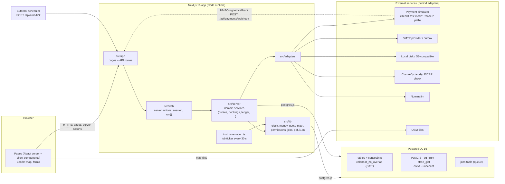
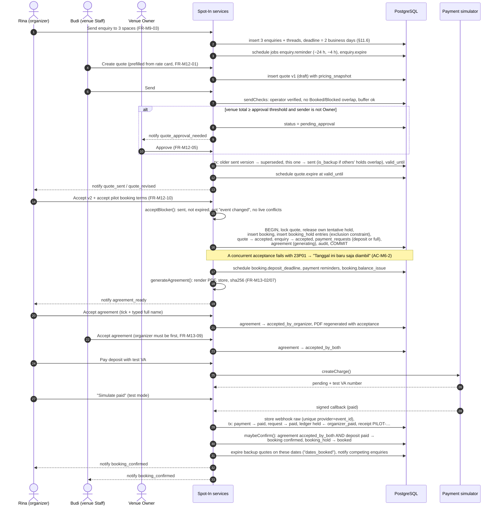
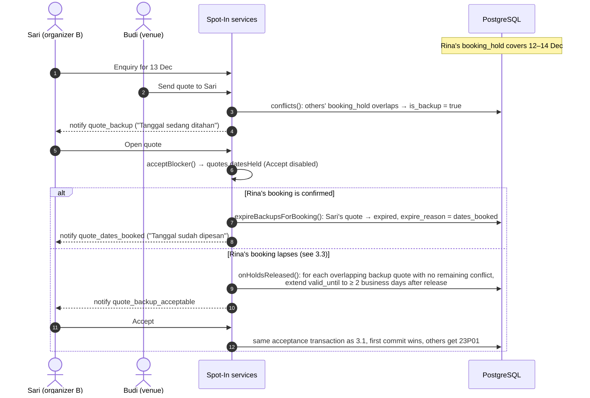
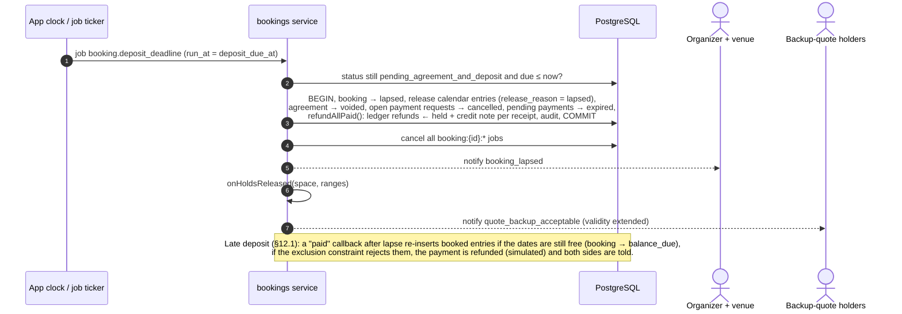
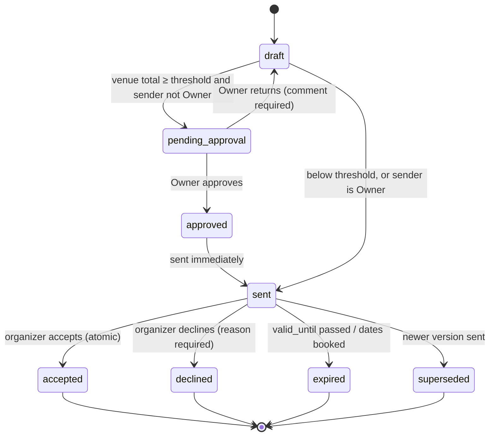
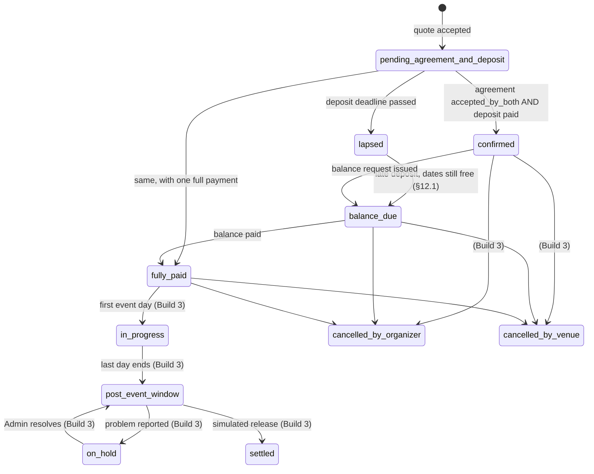

# Spot-In — Technical Design

| | |
|---|---|
| **Product** | Spot-In course pilot (MVP) |
| **Implements** | [`docs/PRD.md`](PRD.md) v1.2 — the PRD is the source of truth; if this document and the PRD disagree, the PRD wins |
| **Status** | Living document. Build 1 done (on `main`); Build 2 in progress (branch `build-2`, not yet merged); Build 3 planned |
| **Date** | 6 November 2026 |
| **Related** | [`AGENTS.md`](../AGENTS.md) (contributor rules), [`docs/features.json`](features.json) (requirement status), [`docs/build-1-plan.md`](build-1-plan.md), [`docs/PRD-review.md`](PRD-review.md), [`docs/mockups/`](mockups/README.md), [`docs/pilot-deletion.md`](pilot-deletion.md) |

This document describes **how** the PRD is built: the architecture, the data model, the state machines, the money rules in code, and the safety rules of pilot mode. It describes the code as it is. Parts that exist only on the `build-2` branch are marked **(Build 2, in progress)**. Parts that are not built yet are marked **(Build 3, planned)** and describe intent only.

---

## Contents

1. [Goals and non-goals](#1-goals-and-non-goals)
2. [Architecture overview](#2-architecture-overview)
3. [Key flows (sequence diagrams)](#3-key-flows-sequence-diagrams)
4. [Data model](#4-data-model)
5. [State machines](#5-state-machines)
6. [Money handling](#6-money-handling)
7. [Time: app clock, business days and the job queue](#7-time-app-clock-business-days-and-the-job-queue)
8. [Permissions model](#8-permissions-model)
9. [Localization (i18n catalog)](#9-localization-i18n-catalog)
10. [Generated documents (PDF)](#10-generated-documents-pdf)
11. [Security and privacy](#11-security-and-privacy)
12. [Accessibility and UI](#12-accessibility-and-ui)
13. [Testing strategy](#13-testing-strategy)
14. [Build plan status](#14-build-plan-status)
15. [Risks, known gaps and open questions](#15-risks-known-gaps-and-open-questions)
16. [Appendix: code map](#appendix-code-map)

---

## 1. Goals and non-goals

### 1.1 Goals

The design serves the MVP goals in PRD §3.1:

| PRD goal | What the design must make possible |
|---|---|
| PG1 | One booking loop end to end: enquiry → quote → revision → acceptance → pilot agreement → sandbox deposit → Confirmed → sandbox balance |
| PG2 | One enquiry fanned out to several spaces, and a side-by-side comparison of the returned quotes |
| PG3 | An unlisted event page with free registration and a QR pass for a confirmed booking (Build 3) |
| PG5 | No sensitive personal data can be stored, and every user has accepted the pilot notice |
| PG6 | Fees, PPN, deposit, balance, hold, release and refunds reconcile to the Rupiah in a sandbox ledger |

Engineering goals that follow from them:

- **Correct under concurrency.** Two people must never hold or book the same space and time (FR-M6-07, AC-M6-2). The database enforces this, not application code.
- **Deterministic money.** Integer Rupiah, a single rounding rule, and an append-only ledger that can be checked (PRD §11.2, FR-M16-07).
- **Demonstrable time.** Every deadline can be moved forward live in the demo with an application clock (FR-M38-10).
- **Replaceable integrations.** Every external service sits behind an adapter so a real provider replaces only the adapter (FR-M14-12, PRD §10).
- **Small and cheap to run.** One Next.js app and one PostgreSQL database; no separate search engine, queue or cache.

### 1.2 Pilot-mode constraints (always on)

These come from PRD §3.3, §7.19 (M38) and `AGENTS.md`. They are design constraints, not features to switch off.

| Constraint | How it is enforced |
|---|---|
| No real money (NG-P1) | The config guard refuses to start if `PILOT_MODE` is not on or a payment key is not a test key (`src/lib/config.ts`, FR-M14-13, FR-M38-07). Payments go through a simulator (§2.4). |
| Nothing is binding (NG-P2) | Pilot banner on every page; every PDF carries the PILOT watermark (FR-M38-01, §10). |
| No ID, bank or card data (NG-P3, FR-M38-04) | No such columns exist; `scripts/pii-scan.ts` checks column names and scans text for 16-digit NIK/card-like numbers (§11.2). |
| Invite-only (FR-M38-02) | Sign-up requires an open `pilot_invites` row for the email. |
| Not indexed (NG-P4, FR-M28-05) | The root layout sends `robots: noindex, nofollow` on every page; there is no sitemap. |
| Email and in-app only (NG-P5) | The only notification channels are the `notifications` table and the email adapter. |
| Bahasa Indonesia only, i18n-ready (NG-P6) | One message catalog, `messages/id.json` (§9). |
| One property per operator, small role set (NG-P8) | `properties.operator_id` is unique; roles are checked by a fixed matrix (§8). |

### 1.3 Non-goals for this design

Everything in the PRD §7.20 backlog: real escrow and payouts, e-signature and e-meterai, Faktur Pajak, PPh 4(2), claims and disputes, change requests, child spaces and floor plans, public event discovery, paid ticketing, WhatsApp/SMS, English. The design keeps seams for some of them (payment adapter, catalog-based strings), but builds none of them.

---

## 2. Architecture overview

### 2.1 Stack

| Layer | Choice | Notes |
|---|---|---|
| Web framework | **Next.js 16** (App Router, React 19, server components, **server actions**) + TypeScript strict | Pages and API routes in `src/app` use Bahasa Indonesia slugs (`/cari`, `/pemesanan/[id]`, `/venue/enquiry/[id]/penawaran`). |
| UI | Tailwind CSS v4 + shadcn/ui (Radix) components, ported from `docs/mockups` | The move onto the mock-up design system is on `build-2` (commit "UI: move the app onto the mock-ups design system"). |
| Database | **PostgreSQL 16** with **PostGIS**, **pg_trgm**, **btree_gist**, plus `citext` and `unaccent` | Data, availability, distance, fuzzy search, jobs, rate limits and settings all live here. |
| Data access | **postgres.js** with tagged-template SQL; plain SQL migrations in `db/migrations` | No ORM. The Build 1 plan named Drizzle; raw SQL was used instead because geography types and exclusion constraints are central. |
| Validation | zod (config), explicit checks in services | |
| Auth | Own implementation: sessions table, argon2 password hashes (`@node-rs/argon2`), email magic links, Google OAuth, TOTP (`otplib`) | The Build 1 plan named Auth.js; a small own session layer was built instead. |
| Maps | Leaflet + react-leaflet with OpenStreetMap tiles; Nominatim geocoding once on save | |
| PDFs and QR | `pdf-lib` (server-side), `qrcode` (for passes, Build 3) | |
| Images | `sharp` (resize, WebP) | |
| Tests | Vitest (unit + integration on a real PostGIS database), Playwright + axe-core (end to end) | |
| CI | GitHub Actions: lint, typecheck, tests, build, e2e, PII scan, `npm audit`, gitleaks | `.github/workflows/ci.yml` |

### 2.2 Layers

The code is split so that business rules never depend on the web framework:

| Layer | Path | Responsibility |
|---|---|---|
| Pages and routes | `src/app` | Render pages (server components), API routes for files, PDFs, webhooks, cron, health. No business rules. |
| Web glue | `src/web` | Session cookie, `actor()`, server actions (`src/web/actions/*`), the `run()` wrapper that maps service errors to catalog messages and adds a reference ID to unknown errors (PRD §12.7). |
| Domain services | `src/server` | One file per module group (`accounts`, `orgs`, `listings`, `calendar`, `search`, `enquiries`, `messaging`, `quotes`, `bookings`, `ledger`, `documents`, `admin`, `notify`). Framework-free, covered by integration tests. Every service call takes an `Actor` and checks permissions itself. |
| Core library | `src/lib` | Config and pilot guard, DB pool, app clock, business days, time zones, money, quote math, permissions matrix, masking, settings, jobs, audit, rate limits, PDF renderer, i18n. |
| Adapters | `src/adapters` | Payments, email, storage, virus scanner, geocoder. The only code that talks to the outside world. |
| Schema | `db/migrations` | `001_core.sql` (Build 1 schema), `002_reference_data.sql` (holidays, search synonyms), `003_search_doc.sql` (search document and indexes), `004_quotes_bookings_payments.sql` (Build 2, in progress). |

### 2.3 Architecture diagram



### 2.4 Adapters

All external calls go through `src/adapters` (`AGENTS.md`, PRD §10). Each adapter picks a driver from config.

| Adapter | File | Drivers | Notes |
|---|---|---|---|
| Payments | `payments.ts` | `Simulator` only (Build 2, in progress) | Interface `PaymentProvider.createCharge()`. The simulator returns test instructions (test VA number, test QRIS string, test e-wallet, test card hint) and produces HMAC-signed callbacks with the same states a provider would send: `paid`, `expired`, `failed` (FR-M14-13). A Xendit test-mode driver is not built (open question Q22). |
| Email | `email.ts` | `outbox` (dev/test/demo), `smtp` | Every email is first written to `email_outbox`; the `outbox` driver stops there and the dev viewer `/dev/mail` shows it (not in the pilot environment). Bounces are recorded on the user (FR-M21-07). |
| Storage | `storage.ts` | `local`, `s3` (SigV4 signing written by hand) | Files are served only through `/api/files/[id]` with an HMAC-signed, expiring URL, and only if `scan_status = 'clean'`. |
| Virus scan | `scanner.ts` | `eicar` (dev/test: detects the EICAR test string), `clamd` | Every upload is scanned before it is stored (FR-M9-02, FR-M10-02). |
| Geocoder | `geocoder.ts` | `nominatim`, `fake` | Called once on save, results cached in `geocode_cache`; the map pin is the source of truth (PRD §10). |

### 2.5 Request handling

- **Reads** happen in server components that call services directly with the current `Actor` (user ID + IP).
- **Writes** go through server actions in `src/web/actions/*`. Each action is wrapped in `run()`, which converts `AppError` (catalog key + values), `PermissionError` and `NotVerifiedError` into a user-facing message. Unknown errors are logged with an 8-character reference ID that is shown to the user (§12.7).
- **API routes** exist only where a browser or an external system needs a plain HTTP endpoint: file and PDF downloads, the account data export, the payment webhook, the cron tick, Google OAuth, the message poll, and `/api/health`.

---

## 3. Key flows (sequence diagrams)

### 3.1 Enquiry → quote → acceptance → agreement → sandbox deposit → Confirmed

(Build 1 for the enquiry; Build 2, in progress, for the rest. PRD §6.2–§6.5.)



### 3.2 Backup quote on held dates

(Build 2, in progress. PRD §6.6, FR-M12-13, AC-M12-4/5.)



Notes:

- A quote can't be sent at all for dates that are **Booked** or **Blocked**; the venue sees the conflicting booking reference (§12.1).
- `is_backup` is set when the quote is sent. Whether Accept is enabled is computed live by `acceptBlocker()` from the calendar each time the quote is shown or accepted, so a quote that loses a race simply shows "dates held" again behind the new booking hold.
- Releasing or expiring a **tentative** hold also calls `onHoldsReleased()` (`src/server/calendar.ts`), so backup quotes behind tentative holds behave the same way.

### 3.3 Lapse (agreement or deposit deadline missed)

(Build 2, in progress. PRD §6.5 step 5, FR-M14-06, §12.3, §12.4.)



### 3.4 Build 3 flows (planned)

Event page → registration → pass → check-in (PRD §6.8–§6.9), post-event window and simulated release (§6.10), and cancellations with policy-based refunds (§6.11–§6.12) are not built. They will reuse the same building blocks: the job queue for the post-event window and the 10:00 release on the next business day (`nextBusinessDayAt()` already exists in `src/lib/business-days.ts`), the ledger `post()` function for release and refunds, and `renderPdf()` for passes and settlement statements.

---

## 4. Data model

### 4.1 Conventions

- Primary keys are `uuid` (`gen_random_uuid()`), except append-only logs (`bigserial`).
- All instants are `timestamptz`. Local dates and times (event days, operating hours) are stored as text in JSON and interpreted in the **property's** time zone (`properties.timezone` ∈ `Asia/Jakarta`, `Asia/Makassar`, `Asia/Jayapura`).
- All money is `bigint` integer Rupiah; rates are integer **basis points** (1% = 100 bps).
- Emails are `citext`. Small nested structures (rate seasons aside) use `jsonb`: quote lines and totals, event days, property required documents, space capacities, agreement acceptances.
- Every timestamp written by a service comes from the application clock (§7.1), not from `now()` in SQL, so the demo clock affects data too. (Exceptions: `settings.changed_at` and `jobs.created_at` use database `now()`.)

### 4.2 Main tables

**Build 1 (on `main`)** — `001_core.sql`, `002_reference_data.sql`, `003_search_doc.sql`:

| Area | Tables | Key constraints and notes |
|---|---|---|
| Platform | `settings`, `holiday_calendar`, `audit_log`, `jobs`, `rate_limits`, `geocode_cache`, `search_synonyms` | `audit_log` has a trigger that raises on UPDATE/DELETE (append-only). `jobs.unique_key` is unique so rescheduling replaces a job. Holidays seeded for 2026–2027 from the SKB 3 Menteri lists (FR-M24-11). |
| Accounts (M1, M38) | `users`, `consent_records`, `pilot_invites`, `sessions`, `auth_tokens` | `users.email` unique (citext). Only one open invite per email (partial unique index). Session and auth tokens are stored as SHA-256 hashes only. **No column for NIK, NPWP, NIB, ID documents, bank or card numbers.** |
| Files | `files` | `scan_status` ∈ clean/infected/error; `purpose` enumerates allowed uses. |
| Organizations (M2, M3) | `organizations`, `memberships`, `org_invites`, `org_audit_log` | `memberships` unique on `(user_id, org_kind)`: at most one venue operator and one organizer org per user (§4.2). A CHECK ties roles to org kind (venue: owner/staff/viewer; organizer: owner/member). `org_audit_log` is append-only. `approval_threshold > 0` or null. |
| Listings (M4, M5) | `properties`, `spaces`, `rate_cards`, `rate_seasons`, `add_ons`, `tax_settings` | `properties.operator_id` **unique** (one property per operator). `properties.geo` is `geography(Point, 4326)` with a GiST index. `spaces.max_capacity` is a generated column. `rate_cards.from_price` NOT NULL (FR-M5-06). `tax_settings.service_charge_bps` 0–10000. |
| Calendar (M6) | `calendar_entries` | See §4.3. |
| Search (M7, M8) | `spaces.search_doc` (trigger-maintained), `spaces.search_tsv` (generated), `shortlists`, `shortlist_items`, `share_links` | GIN trigram index on `search_doc`, GIN index on `search_tsv`; `pg_trgm.word_similarity_threshold = 0.5` set per database. |
| Enquiries (M9) | `events`, `event_files`, `enquiries` | Partial unique index: one **open** enquiry per (event, space). `decline_reason` is an enumerated CHECK. |
| Messaging (M10) | `threads`, `messages`, `thread_reads`, `saved_replies` | `messages.body` keeps the original (Admin only); `display_body` is masked until confirmation (FR-M10-03). Soft delete via `deleted_at`. |
| Notifications, reports | `notifications`, `email_outbox`, `reports` | |

**Build 2 (in progress, `004_quotes_bookings_payments.sql` on `build-2`):**

| Table | Purpose | Key constraints |
|---|---|---|
| `quotes` | Versioned quotes (M12) | `unique (enquiry_id, version)`; status CHECK (§5.2); `lines`, `totals`, `pricing_snapshot`, `payment_schedule`, `policy_snapshot` are JSON snapshots taken at creation so later rate-card or admin-setting changes never change a quote (FR-M4-10, FR-M24-03). `validity_days` 1–60. |
| `quote_templates` | Saved line items per space (FR-M12-04) | Table exists; no UI yet. |
| `bookings` | One per accepted quote | `quote_id` unique; `reference` unique (`BK-0001`…); status CHECK with all §9.2 states; deadlines `deposit_due_at`, `balance_due_at`, `balance_request_at`; `event_start_at`/`event_end_at`; Build 3 columns (`post_event_window_ends_at`, `release_scheduled_at`, `at_risk`) already present. |
| `agreements` | Pilot agreement (M13) | `booking_id` unique; `sha256` of the stored PDF; `acceptances` JSON array of `{side, userId, typedName, at, ip}`; `attempts`/`last_error` for generation retries. |
| `payment_requests` | What is owed and when | `unique (booking_id, kind)` with kind ∈ deposit/balance/full; `amount = venue_part + fee_part`; `amount > 0`. |
| `payments` | Sandbox charges | `provider_ref` unique; `method` ∈ test_va/test_qris/test_ewallet/test_card only; `refunded_amount`. |
| `payment_webhooks` | Raw callbacks | `unique (provider, event_id)` — the idempotency key; `signature_ok` recorded. |
| `receipts`, `receipt_counters` | Pilot receipts and credit notes (M15) | `number` unique; `kind` ∈ receipt/credit_note; credit notes point to the original with `refers_to` (never delete). Counters are per issuer and also generate booking references. |
| `ledger_entries` | Double-entry sandbox ledger (M16) | `amount > 0`; `debit_account <> credit_account`; append-only trigger. |

Build 2 also adds foreign keys from `threads.booking_id` and `calendar_entries.booking_id` to `bookings`, and widens `files.purpose` with `generated_pdf`, `compliance_document`, `problem_photo` and `event_cover` (the last three are for Build 3).

**Build 3 (planned)** will add tables for the PRD §9.1 entities not yet present: `ComplianceItem`, `Cancellation`, `Settlement`, `ProblemReport`, `EventPage`, `Session` (event session), `RegistrationQuestion`, `Registration`, `Pass`.

### 4.3 Availability: the `calendar_no_overlap` constraint

```sql
create table calendar_entries (
  id uuid primary key default gen_random_uuid(),
  space_id uuid not null references spaces (id) on delete cascade,
  during tstzrange not null check (not isempty(during)),
  kind text not null check (kind in ('block', 'tentative_hold', 'booking_hold', 'booked')),
  enquiry_id uuid, booking_id uuid, series_id uuid, reason text,
  expires_at timestamptz, released_at timestamptz, release_reason text,
  created_by uuid references users (id) on delete set null,
  created_at timestamptz not null,
  constraint calendar_no_overlap exclude using gist (space_id with =, during with &&) where (released_at is null)
);
```

This is the core of FR-M6-07 and FR-M12-11:

- **One rule for all kinds.** No two *active* (not released) entries on the same space may overlap, whatever their kind. Blocks, tentative holds, booking holds and bookings all compete for the same time. `btree_gist` lets `space_id with =` sit in the same GiST constraint as the range.
- **Atomic by construction.** Placing a hold, accepting a quote and a late deposit re-insert all run in a transaction that inserts calendar rows. If another transaction committed an overlapping row first, PostgreSQL raises `23P01` (exclusion violation). `isOverlapError()` turns this into a friendly message ("Tanggal ini baru saja diambil", "calendar.holdConflict"). Tests fire two acceptances at once and assert exactly one booking hold (AC-M6-2) and two holds at once (FR-M6-07).
- **Release, never delete.** Releasing an entry sets `released_at` and a `release_reason` (`expired`, `released`, `converted_to_booking_hold`, `lapsed`); history stays.
- **Ranges.** `rangesForDays()` turns event days into ranges: whole local days (00:00–24:00 in the property time zone) for day and half-day spaces, exact hours for hourly spaces; an end before the start means the next day (§12.1).
- **Lazy expiry.** `releaseExpiredHolds()` runs before every conflict check, so an expired tentative hold never blocks new work even if its job has not run yet.
- **Buffer time** (FR-M6-08) is not part of the constraint; `bufferConflict()` checks neighbouring entries before a hold or quote.
- **What organizers see.** `publicAvailability()` collapses states to Available / Unavailable / Limited (holds) (FR-M6-02).

### 4.4 Search

Search (FR-M7-01…13) is one SQL query in `src/server/search.ts`:

- Structured filters (type, city/area, capacity, power, permitted activities, verified only, budget).
- **Availability in the same query**: a `not exists` anti-join on active `calendar_entries` overlapping the requested dates, so a booked space is never shown as available (FR-M7-12). Holds are excluded unless "show limited availability" is on.
- **Distance** with PostGIS `ST_Distance` on `properties.geo` (FR-M7-03, "near me" FR-M7-13).
- **Keywords**: each word expanded through `search_synonyms` ("jaksel" → "jakarta selatan", "aula" → "hall"), then matched with trigram word similarity (`<%`) or full-text (`@@ plainto_tsquery('simple', …)`) on the unaccented `search_doc` (FR-M7-10).
- Target: p95 ≤ 500 ms on 5,000 spaces / 50,000 calendar entries (PRD §8); `npm run db:seed:perf && npm run perf:search` measures it.

---

## 5. State machines

State names in the database match PRD §9.2. Transitions are guarded in SQL (`update … where status = '<expected>'` or `select … for update`), so a stale request can't move a record twice.

### 5.1 Enquiry (Build 1)

```mermaid
stateDiagram-v2
  [*] --> submitted
  submitted --> viewed: venue opens
  submitted --> info_requested
  viewed --> info_requested: venue asks
  info_requested --> responded: organizer replies
  responded --> info_requested
  submitted --> quoted: quote sent
  viewed --> quoted
  responded --> quoted
  info_requested --> quoted
  quoted --> accepted: quote accepted (Build 2)
  submitted --> declined: reason required
  viewed --> declined
  responded --> declined
  submitted --> expired: 2 business days, no reply
  viewed --> expired
  quoted --> withdrawn: organizer (from any open state)
  quoted --> lost: organizer marks Lost (from any open state)
  accepted --> [*]
  declined --> [*]
  expired --> [*]
  withdrawn --> [*]
  lost --> [*]
```



- "Open" states are `submitted`, `viewed`, `info_requested`, `responded` and `quoted`. The organizer can withdraw an enquiry or mark it Lost from any open state; both release the enquiry's tentative hold and cancel its jobs (FR-M9-10).
- The response deadline is 2 business days in the property's time zone (§7.2), with reminder jobs at 24 h and 4 h before and an `enquiry.expire` job at the deadline (FR-M9-07). Any venue reply records `first_response_at` for response-time statistics.
- Limits: 5 spaces per send, 10 open enquiries per event, 20 new enquiries per organization per day (FR-M9-03); a user can't enquire to their own operator's space (§12.6).

### 5.2 Quote (Build 2, in progress)



- **Versions.** A revision is a new row with `version + 1`, copied from the latest version and keeping line IDs so the diff can match lines (FR-M12-07). Sending a version supersedes the previous sent one in the same transaction, so only the latest can be accepted. Organizers never see `draft`, `pending_approval` or `approved` rows.
- **Backup flag.** `is_backup` is set at send time if another party's tentative or booking hold overlaps (§3.2).
- **Event changed.** Editing the event sets `event_changed = true` on its sent quotes; `acceptBlocker()` refuses them until the venue re-sends (FR-M9-09).
- **Expiry.** `quote.expire` runs at `valid_until`; backup quotes may have had `valid_until` extended. `expire_reason` is `validity` or `dates_booked`.
- `withdrawn` is allowed by the schema (PRD §9.2) but no venue action produces it yet.

### 5.3 Booking (Build 2 in progress; later states Build 3)



- **Confirmed** means both agreement acceptances **and** the deposit (or full payment) are in (PRD §11.2). `maybeConfirm()` runs after each agreement acceptance and each successful payment, locks the booking row and checks both conditions; on success it turns `booking_hold` entries into `booked`.
- On confirmation, contact phones become visible in the booking workspace (FR-M1-05) and message masking stops for the thread (FR-M10-03).
- A missed balance does **not** lapse the booking: the `booking.balance_missed` job notifies the venue Owner, who can extend once by up to 3 days (`extendBalance()`) or cancel under the organizer policy (cancellation is Build 3) (FR-M14-06).
- The cancellation and post-event states are already allowed by the schema CHECK; no code moves a booking into them yet.

### 5.4 Other machines

| Machine | States (as stored) | Build |
|---|---|---|
| Calendar entry | active (`released_at is null`) → released with reason `expired` / `released` / `converted_to_booking_hold` / `lapsed`; `booking_hold` → `booked` (kind change on confirmation) | 1–2 |
| Agreement | `generating` → `generated` → `accepted_by_organizer` → `accepted_by_both`; any → `voided` (lapse) | 2 |
| Payment request | `open` → `paid` / `expired` / `cancelled` | 2 |
| Payment | `pending` → `paid` / `expired` / `failed`; `paid` → `refunded` (simulated) | 2 |
| Space | `draft` → `in_review` → `published` ⇄ `unpublished`; `suspended` (Admin) | 1 |
| Organization verification | `unsubmitted` → `pending` → `verified` / `rejected` | 1 |
| Compliance item, event page, registration, pass | as PRD §9.2 | 3 (planned) |

`generating` is an implementation state not in PRD §9.2: the booking row and agreement row are created in the acceptance transaction, and the PDF is rendered right after it. If rendering fails it is retried every minute by an `agreement.generate` job; after 3 failures the Admins are emailed (§12.3).

---

## 6. Money handling

### 6.1 Integer Rupiah and rounding

`src/lib/money.ts`:

- Every amount is a JavaScript safe integer (`assertRupiah`) and a `bigint` in the database. The DB driver returns `bigint` columns as JS `BigInt`; `num()` converts them back (safe below 2^53).
- Rates are basis points. `pct(amount, bps)` = `mulDivHalfUp(amount, bps, 10 000)`.
- `mulDivHalfUp(a, b, c)` computes `round(a × b / c)` **half-up** using `BigInt` arithmetic, so there is no floating-point error.
- Each line is rounded once; totals are sums of rounded lines (PRD §11.2).
- Display: `formatRupiah()` → "Rp 25.000.000" (FR-M25-02); input parsing accepts "25.000.000", "Rp 25.000.000" and "25000000".

### 6.2 Quote totals

`quoteTotals(lines, pricingSnapshot)` in `src/lib/quote-math.ts`:

| Figure | Rule in code |
|---|---|
| Line amount | `round(unitPrice × quantity)` (quantity to 2 decimals) − line discount, never below 0 |
| Rental + add-ons | sum of line amounts |
| Service charge | `pct(rental + add-ons, serviceChargeBps)` from the operator's tax settings |
| PPN | only if the operator is PKP: `(taxable lines + service charge) × ppnRateBps × DPP numerator / (10 000 × DPP denominator)`, half-up. Default 12% on DPP 11/12 = effective 11% (PRD §11.4) |
| Venue total | rental + add-ons + service charge + PPN |
| Spot-In fee | `pct(rental + add-ons, feeBps)` clamped to [min, max]; 0 if there is nothing to rent. Default 3%, min Rp 50.000, max Rp 2.500.000 (PRD §11.1) |
| Organizer total | venue total + Spot-In fee |

Commission (default 10%) is stored in the pricing snapshot but is only charged at release, which is Build 3.

The **pricing snapshot** (PKP flag, service charge, PPN rate and DPP rule, fee rate and caps, commission) is copied into the quote when the draft is created, and the cancellation policy tiers are copied into `policy_snapshot`. Admin changes apply only to quotes created afterwards (FR-M24-03, AC-M24/M25/M26-2 is tested).

**Worked example** (PRD §11.2, AC-M12-1, covered by `tests/unit-core.test.ts` and `tests/build2.test.ts`): rental 3 × Rp 25.000.000 + electricity 40 × 3 × Rp 50.000 = 81.000.000; PPN 8.910.000; venue total 89.910.000; fee 2.430.000; organizer total 92.340.000; deposit 47.385.000; balance 44.955.000.

### 6.3 Payment schedule rules

`paymentPlan()` and `validateSchedule()` in `src/lib/quote-math.ts` (FR-M12-02, FR-M15-09):

| Rule | Implementation |
|---|---|
| Deposit % | ≥ admin minimum (default 20%), < 100%; default 50% |
| Deposit due | N days after acceptance (1–7, default 3), at **23:59 property time** |
| Deposit amount | `pct(venue total, deposit %)` + the whole Spot-In fee |
| Balance due | N days before the first event day (≥ 3, default 14), at 23:59 property time |
| Balance amount | venue total − venue part of the deposit (no fee) |
| Balance request issued | 00:00 property time, 7 days before the balance due date; immediately if that moment has passed (AC-M15/M16-2, -3) |
| One full payment | if the quote says "full", or acceptance is at/after the balance due date, or the deposit due date would fall on/after it. Due at the deposit due date. |

Only the deposit (or full) request is created at acceptance; the balance request is created by the `booking.balance_issue` job. Payment reminders are scheduled 3 days and 1 day before the due date and on the due date (12 hours before the 23:59 deadline) (FR-M14-05).

### 6.4 Double-entry ledger

`src/server/ledger.ts` (FR-M16-07; Build 2, in progress):

- Each row moves `amount` (> 0) from `credit_account` to `debit_account` for one booking. Rows are **append-only** (database trigger). A balance per account is the sum of debits minus credits; across all accounts it is always zero.
- Accounts used today: `organizer_paid` (source of sandbox money), `held`, `refunds`. Accounts defined for Build 3 release: `venue_payable`, `spotin_commission`, `spotin_fee`.

| Event | Entry | Status |
|---|---|---|
| Payment succeeded | debit `held`, credit `organizer_paid`, amount = payment | Build 2 |
| Lapse refund / late deposit refund | debit `refunds`, credit `held`, amount = paid − already refunded | Build 2 |
| Simulated release | debit `venue_payable` / `spotin_commission` / `spotin_fee`, credit `held` | Build 3 (planned) |
| Policy-based cancellation refund | debit `refunds`, credit `held`; retained part to `venue_payable` with commission on the ex-PPN share kept (PRD §11.3) | Build 3 (planned) |

### 6.5 Reconciliation

`reconcile(bookingId)` (FR-M24-05, AC-M24/M25/M26-3) compares independent sources and returns a list of problems:

| Check | Problem code |
|---|---|
| Ledger inflow (credits to `organizer_paid`) = sum of paid payments | `ledger_inflow_vs_payments` |
| Ledger refunds = sum of `payments.refunded_amount` | `ledger_refunds_vs_payments` |
| Receipts − credit notes = paid − refunded | `receipts_vs_payments` |
| Paid ≤ the accepted quote's organizer total | `paid_above_quote` |
| Sum of all account balances = 0 | `ledger_unbalanced` |

The Admin ledger page (`/admin/buku-besar`) lists bookings with their reconciliation result; the booking workspace shows it too. A test alters ledger rows directly in the database and asserts the booking is flagged.

### 6.6 Receipts

On each successful payment one receipt is issued in the same transaction (FR-M15-01, -02): number `PILOT-<issuer prefix>-<5-digit sequence>` from a per-issuer counter; lines are the venue part split into ex-PPN amount and PPN (PPN pro-rated from the quote with half-up rounding), plus a separate "Biaya layanan Spot-In" line when the payment includes the fee. The PDF is titled as a pilot receipt, not a tax invoice. A refund creates a **credit note** pointing to the original receipt; receipts are never deleted.

---

## 7. Time: app clock, business days and the job queue

### 7.1 Application clock

`src/lib/clock.ts` (FR-M38-10). Every deadline, expiry, reminder, job and service timestamp reads `now()` from here, never `Date.now()` directly (`AGENTS.md`).

- `now()` = system time + an offset stored in `settings.demo_clock_offset_ms`, cached for 1 second.
- The offset is read only when `APP_ENV` is `demo` or `test` (`demoClockEnabled`). In `development` and `pilot` it is always 0, and `setClockOffsetMs()` throws.
- The clock only moves forward. An Admin moves it from the admin settings page (`advanceDemoClock()`); the change is written to the admin audit log and an immediate `tick()` runs due jobs, so holds expire, reminders fire and deadlines pass during the demo (AC-M38-7).

### 7.2 Business days and time zones

`src/lib/business-days.ts`, `src/lib/time.ts` (PRD §11.6):

- A business day is Monday–Friday and not in `holiday_calendar` (national holidays and cuti bersama, editable by Admins, FR-M24-11), evaluated in the property's time zone.
- `businessDayDeadline(start, n, tz, holidays)`: 23:59 of the n-th business day after the start day; the start day never counts. Tested with the PRD example (Friday 16:00 WIB, Monday holiday → Wednesday 23:59 WIB).
- `nextBusinessDayAt(after, "10:00", tz, holidays)`: for the Build 3 release rule (§11.7), already unit-tested across a holiday.
- `businessHoursBetween()`: 09:00–17:00 on business days, for median response time (FR-M22-03, Build 3 dashboards).
- Time zone of a property is prefilled from the pin's longitude (WIB/WITA/WIT) and editable (FR-M4-01).

### 7.3 Job queue

`src/lib/jobs.ts` and `src/server/jobs.ts` — a PostgreSQL table instead of a separate queue service (the Build 1 plan named pg-boss; the table approach was chosen so jobs follow the app clock).

- `schedule(kind, runAt, payload, { uniqueKey })` inserts or **replaces** a job by `unique_key` (e.g. `booking:<id>:deposit_deadline`), so rescheduling is idempotent. It can run inside the caller's transaction.
- `cancelJobs(prefix)` cancels pending jobs by key prefix (e.g. all `booking:<id>:` jobs on lapse).
- `tick()` claims one due job at a time with `for update skip locked` where `run_at <= now()` (app clock), runs its handler, and marks it `done`. A failure retries after 60 s; after 3 attempts the job is `failed`.
- Handlers must be safe to run late or twice: each re-reads the record and checks its status and deadline before acting (e.g. `depositDeadlineJob` returns if the booking is no longer pending or the deadline moved).
- **Triggers:** `instrumentation.ts` starts a 30-second ticker inside the Node server (not in tests, or when `DISABLE_JOB_TICKER=1`); hosts can also call `POST /api/cron/tick` with `Authorization: Bearer $APP_SECRET`; moving the demo clock ticks immediately; `npm run jobs:tick` runs one tick from the CLI.

| Job kind | Scheduled when | Build |
|---|---|---|
| `enquiry.reminder` (24 h, 4 h), `enquiry.expire` | Enquiry sent | 1 |
| `hold.expiring` (−24 h), `hold.expire` | Tentative hold placed | 1 |
| `admin.daily_reminder` | Server start; daily | 1 |
| `quote.expire` | Quote sent; backup validity extended | 2 |
| `agreement.generate` | Agreement rendering failed (retry) | 2 |
| `booking.deposit_deadline` | Quote accepted | 2 |
| `booking.payment_reminder` (d3, d1, d0) | Deposit/full request created; balance issued; balance extended | 2 |
| `booking.balance_issue` | Quote accepted (split schedule) | 2 |
| `booking.balance_missed` | Balance issued or extended | 2 |
| Readiness warnings, post-event window end, release, registration hold release | — | 3 (planned) |

---

## 8. Permissions model

### 8.1 Roles

From PRD §4.3, coded in `src/lib/permissions.ts` as two fixed tables:

| Permission key | Venue roles | Organizer roles |
|---|---|---|
| `org.manage` | Owner | Owner |
| `venue.threshold` | Owner | — |
| `listing.edit`, `calendar.edit`, `enquiry.respond`, `quote.send`, `documents.review`, `saved_replies.edit` | Owner, Staff | — |
| `quote.approve`, `booking.cancel` | Owner | Owner (`booking.cancel`) |
| `enquiry.view`, `booking.view` | Owner, Staff, Viewer | Owner, Member |
| `shortlist.edit`, `event.edit`, `enquiry.send`, `message.send`, `quote.accept`, `documents.upload`, `event_page.edit` | — | Owner, Member |
| `attendees.export` | — | Owner |

The database backs this up: a membership's role must belong to its org kind (CHECK), and a user can be in at most one org of each kind. A **Spot-In Admin** is `users.is_admin`; admin pages also require TOTP enrolment and a 2FA-passed session (`requireAdminPage()`, FR-M1-03, FR-M24-12).

### 8.2 Server-side checks

- Every service function receives an `Actor` (user ID + IP) and calls `requirePermission()` / `requireOrgPermission()` / `requireAdmin()` itself; pages and actions never decide access (FR-M2-14).
- Records are loaded **through** the actor's organization (e.g. `quoteForVenue` joins quote → enquiry → space → property and compares `operator_id`; `bookingFor` resolves the side from the actor's memberships). A record of another organization, a non-UUID ID and a missing record all raise the same `PermissionError`, shown as "Anda tidak punya akses …", so existence is never revealed (AC-M2-1).
- `requireVerified()` gates enquiry, quote, accept, pay and register on a verified email (FR-M1-02).
- Suspended organizations get `errors.orgSuspended`; unverified operators can't publish or send quotes (FR-M3-03).
- The acting user's role is read from the database on every call, so a role change takes effect on the next request.
- Quote-specific rules: the venue sees all versions; the organizer only sent or later states. Agreement acceptance on the venue side needs `quote.send` (Owner or Staff); balance extension needs Owner (`booking.cancel`).

---

## 9. Localization (i18n catalog)

PRD FR-M25-01/02/05:

- **One catalog**, `messages/id.json` (Bahasa Indonesia), used by next-intl on pages and by `t()` in `src/lib/i18n.ts` for server code (emails, notifications, PDFs, error messages). Services throw `AppError("<catalog key>", values)`; the web layer translates.
- **Lint rule.** ESLint `react/jsx-no-literals` (with a short allow-list of symbols such as "Rp", "m²", "·") fails the build on literal text in JSX (`eslint.config.mjs`).
- **Catalog tests.** `tests/pilot-and-catalog.test.ts` checks that every static key used in `src` exists, that every value of each dynamic key family exists (e.g. notification events, statuses), and that there is a single catalog file. In tests, a missing key throws.
- **Formatting.** "Rp 25.000.000", "12 Des 2026", and times in the property's time zone with a WIB/WITA/WIT label (`src/lib/time.ts`).
- **English later.** Adding `messages/en.json` and a locale switch is the Phase 2 path; no code strings need to move for UI text.

Known gap: the lint rule covers JSX only. A few server-side strings are still literals — the receipt line labels in `src/server/bookings.ts` (Build 2, in progress) — and should move to the catalog before Build 2 is merged.

---

## 10. Generated documents (PDF)

`src/lib/pdf.ts` and `src/server/documents.ts` (Build 2, in progress; FR-M38-01):

- One renderer, `renderPdf(spec)`, takes a document spec of blocks (heading, text, key-value, table, money rows, spacer) and draws A4 pages with `pdf-lib` and the standard Helvetica fonts (characters outside WinAnsi are mapped, e.g. "≥" → ">=").
- **Watermark by construction.** After layout, every page gets a large diagonal "PILOT" watermark, a "PILOT" badge in the top corner and a footer note with page numbers. There is no code path that renders a page without them. PDF metadata also carries "(PILOT)" in the title and "PILOT, not binding" keywords.
- The renderer returns the bytes and their **SHA-256**. For agreements, the hash is stored in `agreements.sha256` so a downloaded file can be checked (FR-M13-07).
- Documents built on it today: quote (FR-M12-09), pilot agreement "Sample agreement (pilot)" with the acceptance record on the last page (FR-M13-02/07/10), receipt and credit note (FR-M15-01), quote comparison (FR-M8-05).
- Planned for Build 3: per-booking statement and CSV (FR-M15-07), settlement statement (FR-M16-09), pass, printable attendee list.
- Generated files are stored through the storage adapter as `files` rows with purpose `generated_pdf` and served only to the two parties of the booking (`/api/documents/*` re-checks access through the services).
- AC-M38-1 asks for a test that generates every document type and finds none without the watermark; the Build 2 tests check the quote and agreement PDFs. Extending the check to every type is listed in §15.

The **pilot banner** ("Mode pilot – pemesanan latihan, tidak mengikat, tanpa pembayaran nyata") is rendered by the root layout on every page, which is stricter than "every page of a booking flow".

---

## 11. Security and privacy

### 11.1 Authentication and sessions

- Passwords hashed with **argon2** (PRD §8). Email magic links and password reset use single-use tokens; tokens and session IDs are random 256-bit values stored only as SHA-256 hashes.
- Session cookie `spotin_session`: `HttpOnly`, `SameSite=Lax`, `Secure` when served over HTTPS, 30-day max age; idle sessions expire after the configured period (default 30 days); sessions can be listed and revoked (FR-M1-04).
- Google sign-in via OAuth; only invited emails can create accounts (FR-M1-11).
- Admin 2FA with TOTP; the TOTP check is rate-limited.
- **Rate limits** (fixed window in PostgreSQL, `src/lib/rate-limit.ts`): sign-up per IP, login per email and per IP, magic link and reset per email, TOTP per user, messages and reports per user, enquiry sends per user. Registration limits (10 per IP per hour per event page, FR-M30-10) come with Build 3.

### 11.2 Data rule (no ID, bank or card data)

- **No fields exist** for ID documents, selfies, NIK, NPWP, NIB, deeds, bank accounts or card numbers (comment at the top of `001_core.sql`; FR-M38-04, AC-M2-2). Phones are optional, unverified contact fields.
- `npm run pii-scan` (`scripts/pii-scan.ts`) fails if any column name matches the blocked list (nik, ktp, npwp, nib, passport, selfie, deed, akta, iban, bank_account, account_number, card_number, cvv) and scans text columns for 16-digit NIK-like or card-like numbers. It runs in CI against the e2e database and before the demo.
- Payment methods are test methods only; the simulator shows a test card *hint*, and no card or VA data entered by a user is stored.
- Registration questions that ask for ID numbers or sensitive data will be refused (FR-M30-02, Build 3).

### 11.3 Pilot guard

`assertPilotSafe()` runs when config is first loaded and throws, so the server **refuses to start**, if `PILOT_MODE` is not on, or if `XENDIT_SECRET_KEY` is set and does not start with `xnd_development_` (FR-M14-13, FR-M38-07, unit-tested). Seed scripts refuse the `pilot` environment; demo and pilot data live in separate databases (FR-M38-06).

### 11.4 Payment webhooks: signatures and idempotency

`POST /api/payments/webhook` → `handleCallback()` (Build 2, in progress; PRD §10, §12.4):

1. **Verify** the `x-callback-signature` header: HMAC-SHA256 (keyed with `APP_SECRET`) over the JSON payload, compared in constant time. Invalid → HTTP 401.
2. **Store raw** in `payment_webhooks` with `signature_ok`, before any processing.
3. **Idempotency:** `unique (provider, event_id)` with `on conflict do nothing`; a second delivery of the same event returns `duplicate` and changes nothing (AC-M14-1 tests a duplicate callback).
4. **Process** inside a transaction: the payment update is guarded by `status in ('pending', 'expired')`, so even a different event for an already-paid payment can't post twice.
5. Mark `processed_at`.

In the pilot the simulator is the only sender: the tester presses "simulate paid / failed / expired" on the payment page and the simulator builds a signed callback that goes through the same handler.

### 11.5 Files

Uploads are type- and size-checked (10 MB; PDF/JPG/PNG, plus DOCX/XLSX for messages), virus-scanned before storage, photos converted to WebP, and served only through `/api/files/[id]?exp=…&sig=…` (HMAC-signed, expiring, `nosniff`, private cache) and only when the scan result is clean (PRD §8).

### 11.6 Unlisted and not indexed

- The root layout sets `robots: { index: false, follow: false }` for every page, and shortlist share pages set it again; there is no sitemap and no structured data. Event pages (Build 3) will be reachable only by link with a random token, excluded from search and any list (FR-M28-05).
- Pass QR codes (Build 3) will encode a URL with a ≥ 128-bit random token (FR-M31-02).

### 11.7 Privacy (UU PDP) and audit

- Consent records (terms, privacy, pilot notice) with version and time at sign-up; 18+ confirmation (FR-M1-09, FR-M38-03/09). The pilot notice names the hosting provider and country from admin settings (still placeholders until Q21 is answered).
- Data export as JSON (`/api/akun/ekspor`) and in-app account deletion (FR-M38-05); a documented, tested deletion job for the pilot end date (`docs/pilot-deletion.md`).
- Contact masking in message text until confirmation; the original is kept for the Admin only (FR-M10-03).
- Append-only `audit_log` (admin, system and user actions with before/after) and `org_audit_log`. Booking acceptance, agreement acceptances, confirmation and lapse are audited and shown as the booking timeline (FR-M17-01, Build 3 for the full workspace).
- CI runs `npm audit --audit-level=high` and gitleaks on every push (PRD §8). The OWASP Top 10 self-check and the restore test are still to be documented (AC-NFR-2/3).

---

## 12. Accessibility and UI

- Target: WCAG 2.1 AA for the booking flow and the event page, registration and pass (PRD §8, AC-NFR-4).
- The UI uses Radix-based shadcn/ui components (keyboard and screen-reader support built in), a skip link to `#main`, `lang="id"`, and visible focus styles.
- Playwright tests run **axe-core** with the `wcag2a`, `wcag2aa`, `wcag21a`, `wcag21aa` tags on the pages they visit and fail on violations (`e2e/helpers.ts`). The Leaflet map container is excluded from the scan; the address text and list view give a non-map alternative.
- Mobile-first layouts for organizer, owner and attendee screens; venue dashboards target laptops (PRD §8). The visual design follows `docs/mockups` (46 screens, 183 states), which also documents the empty, loading, error and permission states from PRD §12.

---

## 13. Testing strategy

| Level | Tool | What it covers |
|---|---|---|
| Unit | Vitest (`tests/unit-core.test.ts`) | Business days (PRD example, holidays, time zones, release past a holiday), formatting, half-up money and the worked example, quote math and payment plan edge cases (balance issued immediately, full payment inside the balance window), masking string table (AC-M9/M10-5), permission matrix vs PRD tables, pilot guard. |
| Integration | Vitest on a real PostGIS database (`spotin_test`) | Service functions end to end with real SQL: accounts and orgs, listings and verification, calendar and concurrent holds, search (typo, synonyms, availability, distance), enquiries and deadlines on the app clock, messaging, admin, catalog completeness, PII scan, deletion job. Build 2 adds `tests/build2.test.ts`: AC-M12-1…5, AC-M2-4, AC-M6-2 (two simultaneous acceptances), AC-M13-1, AC-M14-1/2, AC-M15/M16-1/2, reconciliation tamper test, fee change, event-changed quotes, comparison. |
| End to end | Playwright + axe (`e2e/`) | Demo scripts against a production build and the demo seed. **D1** (venue onboarding) and **D2** (search and enquiry) are on `main` and run in CI. **D3** (quote → approval → revision → comparison PDF → accept) and **D4** (backup quote, agreement, deposit, confirmed, lapse via demo clock) are being written on `build-2`. **D5–D7** come with Build 3. |
| Data safety | `npm run pii-scan` | Runs in CI on the e2e database after D1/D2. |
| Performance | `npm run perf:search` | p50/p95 on the 5,000-space seed. |

Rules (`AGENTS.md`, PRD §13): a requirement is **done** only when all its acceptance criteria pass through a demo step or an automated test; only then are `status: "done"` and `passes: true` set in `features.json`. Tests name the AC IDs they cover. Time-dependent tests move the app clock instead of sleeping.

---

## 14. Build plan status

PRD §14 defines three builds. Status on 6 November 2026, from `docs/features.json` and the code:

| Build | Scope (PRD §14) | Status |
|---|---|---|
| **Build 1 — listings and enquiries** | M1–M10, M24 basics, M25 catalog, M38 invite-only and consent | **Done**, merged to `main` (PR #1). D1 and D2 pass in CI. 67 requirements are `done` in `features.json`. 35 are `in_progress`: mostly Build 1 requirements whose acceptance criteria also need bookings (e.g. FR-M6-05/06/07, FR-M9-09/10, FR-M10-03 after confirmation, FR-M1-05 phone reveal) or Build 2 parts (FR-M38-01 watermarks, FR-M38-10 demo clock, FR-M24-05 ledger view). UI mock-ups merged (PR #2). |
| **Build 2 — quote to confirmed** | M12 incl. backup quotes, M13, M14 sandbox, M15/M16 ledger and receipts, M21, M38 watermarks and demo clock | **In progress** on branch `build-2` (not merged): migration 004, services `quotes.ts`, `bookings.ts`, `ledger.ts`, `documents.ts`, the payment adapter, `pdf.ts`, `quote-math.ts`, screens for the quote builder, quote view, comparison, booking workspace, payment page and Admin ledger, integration tests, and D3/D4 e2e specs being written. `features.json` has not been updated yet (M12–M16 still `not_started`). Exit criteria: D3 and D4 pass; ledger reconciliation clean. |
| **Build 3 — event and after** | M17, M18, M28/M30/M31/M32/M36, M22, M26, post-event window and release | **Planned.** Not started. Exit: D5–D7 and all §13.2 criteria pass. |
| Pilot, course demo, pilot end | PRD §14 | Not started; depend on Q19–Q25. |

Deviations from `docs/build-1-plan.md` (stack choices made during Build 1): postgres.js with raw SQL instead of Drizzle; an own session/auth layer instead of Auth.js; a PostgreSQL `jobs` table on the app clock instead of pg-boss. The plan's intent (Postgres-only, adapters, app clock) is unchanged.

---

## 15. Risks, known gaps and open questions

### 15.1 Technical risks

| Risk | Mitigation |
|---|---|
| Jobs don't run on a host that sleeps idle processes (free tiers) | External scheduler calls `POST /api/cron/tick`; handlers re-check state and tolerate running late; expired holds are also released lazily before every conflict check. |
| Long single-threaded `tick()` loop under many due jobs (e.g. after a big demo-clock jump) | Bounded batch (200 per tick, 1000 after a clock move); `skip locked` allows parallel tickers. Acceptable at pilot scale. |
| Work after the main transaction (notifications, job scheduling, agreement rendering, receipt PDF) is not atomic with it | Each step is idempotent and re-checks status; the agreement has a `generating` state with retries; receipt PDF failure is logged and the receipt row still exists. A transactional outbox is the Phase 2 option. |
| Free-tier limits (tiles, Nominatim, email quota) on demo day | Geocode once and cache; pin is the source of truth; outbox driver for the demo; recorded fallback video (PRD §15.1). |
| A real payment key configured by mistake | The pilot guard refuses to start (§11.3). |
| JS number precision on money | Amounts are checked as safe integers; multiplication and division use `BigInt`. Pilot amounts are far below 2^53. |

### 15.2 Known gaps in the Build 2 code (to fix or decide before merge)

Found while writing this document; each is a small change or a PRD question, not a redesign.

1. **PPN account in the ledger.** FR-M16-07 lists "PPN collected" as a ledger account; the ledger has no such account yet. PPN is visible on quotes and receipts but not as its own ledger balance.
2. **Time zone in payment notifications.** Balance-due, reminder and extension notifications format the due time in `Asia/Jakarta` instead of the property's time zone (FR-M25-02 requires the property zone and label).
3. **Hard-coded receipt line labels** in `src/server/bookings.ts` instead of catalog keys (FR-M25-05; §9).
4. **Agreement-outage deadline extension.** §12.3 extends the deadline by the outage (max 24 h, logged) when agreement generation fails; the code retries and alerts Admins after 3 failures but does not extend the deposit deadline.
5. **Xendit test mode.** Only the simulator exists; `payments()` always returns it. FR-M14-13 allows this when test-mode access is not available (Q22).
6. **Watermark test for every document type** (AC-M38-1): currently checked for quote and agreement PDFs only.
7. **`features.json`** has not been updated for Build 2 requirements yet; it must be after D3/D4 pass.
8. **Webhook provider name** is fixed to `simulator` in `handleCallback()`; a real provider adapter will need to pass its own name and signature scheme.

### 15.3 Open questions for the PRD owner

| # | Question | Current behaviour |
|---|---|---|
| D1 | The approval threshold compares the quote's **venue total (incl. PPN)**. FR-M2-06 says "total". Is that the intended figure? | Venue total |
| D2 | Quote validity and tentative holds run for N × 24 hours from the moment they are sent or placed, not to the end of a local day. Should they end at 23:59 property time like payment deadlines? | N × 24 h |
| D3 | When an Owner sends a quote at or above the threshold, the code records the Owner as approver and sends it directly (no `approved` step). Is that acceptable for AC-M2-4 and the audit trail? | Direct send, approval recorded |
| D4 | One receipt per payment is issued in the venue's number series, with the Spot-In fee as a separate line. PRD §9.1 lists a receipt issuer of `venue` or `spot_in`. Should the fee get its own Spot-In receipt? | One receipt, separate fee line |
| D5 | Should reconciliation also check that the ledger matches the quote's split between venue part and Spot-In fee once release exists (Build 3)? | Totals only |

PRD-level open questions that affect engineering: **Q21** (hosting provider, region, email service — needed for the pilot notice and SMTP/S3 drivers), **Q22** (Xendit test mode or simulator), **Q23** (pilot deletion date — setting `pilot_deletion_date`, default 2027-03-31), **Q19** (PSE registration).

---

## Appendix: code map

| Path | Contents |
|---|---|
| `src/lib/config.ts` | Env schema, pilot guard, environments (`development`, `test`, `demo`, `pilot`) |
| `src/lib/db.ts` | postgres.js pool, `num()` |
| `src/lib/clock.ts` | Application clock and demo offset |
| `src/lib/business-days.ts`, `time.ts`, `holidays.ts` | Business days, time zones, holiday loading |
| `src/lib/money.ts`, `quote-math.ts`, `pricing.ts` | Integer Rupiah, quote totals and payment plan, rate-card pricing and quick estimate |
| `src/lib/permissions.ts` | Role matrix and error types |
| `src/lib/jobs.ts` | Job queue; handlers registered in `src/server/jobs.ts` |
| `src/lib/pdf.ts` | PDF renderer with PILOT watermark |
| `src/lib/masking.ts` | Contact masking |
| `src/lib/settings.ts` | Admin settings and pilot defaults |
| `src/lib/audit.ts`, `rate-limit.ts`, `tokens.ts`, `i18n.ts` | Audit logs, rate limits, tokens/HMAC, catalog |
| `src/server/*` | Domain services (see §2.2) |
| `src/adapters/*` | Payments, email, storage, scanner, geocoder |
| `src/web/*` | Session, server actions, `run()` |
| `src/app/api/*` | Files, documents, account export, payment webhook, cron tick, Google OAuth, message poll, health |
| `db/migrations/*` | Schema, reference data, search document |
| `scripts/*` | Migrate, seed (demo and perf), tick, PII scan, search perf, pilot deletion, catalog keys |
| `tests/*`, `e2e/*` | Vitest and Playwright suites |
